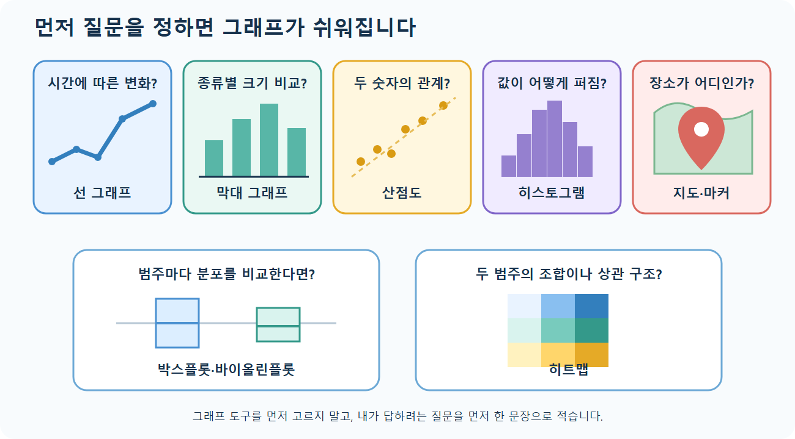

# 공통 핵심 개념 — 전체 수업을 한눈에 보기

[전체 목차](./README.md) · [왕초보 시작하기](./START_HERE.md) · [쉬운 용어사전](./용어사전.md)

## 오늘 이것만 기억하기

> 데이터 공부는 **읽기 → 확인 → 정리 → 계산 또는 학습 → 그림으로 확인**하는 순서입니다.

처음에는 라이브러리 이름을 모두 외우지 않아도 됩니다. “표는 Pandas, 기본 그래프는 Matplotlib, 머신러닝은 scikit-learn” 세 가지만 먼저 기억합니다.

## 1. 전체 데이터 분석 흐름

모든 강의는 다음 한 흐름 안에 있습니다. 요리와 비교하면 데이터를 불러오는 것은 재료 준비, 전처리는 재료 손질, 모델 학습은 조리, 평가는 맛보기와 비슷합니다.

1. **수집/불러오기**: CSV 또는 라이브러리의 예제 데이터를 DataFrame으로 읽습니다.
2. **이해하기**: 행·열 크기, 자료형, 결측치, 기초 통계를 확인합니다.
3. **선택/정제하기**: 필요한 행과 열을 고르고 결측치·이상치를 처리합니다.
4. **변환하기**: 파생 열, 인코딩, 스케일링 등 분석 가능한 형태로 바꿉니다.
5. **요약/학습하기**: `groupby`로 집계하거나 머신러닝 모델을 학습합니다.
6. **평가/시각화하기**: 수치 지표와 그래프로 결과가 타당한지 확인합니다.

핵심은 코드 한 줄을 외우는 것이 아닙니다. 코드를 보며 “지금은 데이터를 읽는 중인가, 정리하는 중인가, 결과를 확인하는 중인가?”를 먼저 묻습니다.

## 2. 라이브러리 역할

| 라이브러리 | 수업에서 부르는 짧은 이름 | 쉽게 말하면 | 등장 강의 |
|---|---|---|---|
| NumPy | `np` | 숫자 계산 도구 | lec01~lec12 |
| Pandas | `pd` | 엑셀 같은 표를 다루는 도구 | lec01~lec12 |
| scikit-learn | `sklearn` | 머신러닝 도구 상자 | lec04~lec05, lec11~lec12 |
| XGBoost | `xgb` | 앞 모델의 실수를 보완하며 트리를 쌓는 도구 | lec12 |
| LightGBM | `lgb` | 큰 데이터도 빠르게 다루도록 설계된 부스팅 도구 | lec12 |
| Matplotlib | `plt` | 가장 기본적인 그래프 도구 | lec06~lec12 |
| Seaborn | `sns` | 표에서 통계 그래프를 쉽게 그리는 도구 | lec06~lec08, lec10~lec12 |
| Plotly | `px`, `go` | 마우스로 움직여 보는 그래프 도구 | lec08, lec10 |
| Folium | `folium` | 지도에 위치를 표시하는 도구 | lec09 |

의존성은 [requirements.txt](./requirements.txt)에 한 번만 모았습니다.

## 3. 행, 열, 인덱스, 축

DataFrame은 행(row)과 열(column)을 가진 2차원 표입니다. **행은 가로 한 줄**, **열은 세로 한 줄**입니다. 사람 명단이라면 한 행은 한 사람, `name` 열은 모든 사람의 이름입니다.

| 표현 | 뜻 | 예 |
|---|---|---|
| `df.shape` | `(행 수, 열 수)` | `(506, 14)` |
| `df.index` | 각 행을 식별하는 라벨 | `0, 1, 2, ...` |
| `df.columns` | 열 이름 | `CRIM`, `RM`, `MEDV` |
| `axis=0` | 행을 대상으로 작업 | `dropna(axis=0)`은 행 삭제 |
| `axis=1` | 열을 대상으로 작업 | `dropna(axis=1)`은 열 삭제 |

`loc`은 **라벨**, `iloc`은 **정수 위치**라는 구분이 전체 Pandas 학습의 기준입니다. 상세 예제는 [lec01](./lec01_DataFrame_기초.md#3-데이터-선택)을 참고합니다.

## 4. 그래프 선택 기준



같은 차트가 여러 시각화 강의에 반복되므로 의미는 여기에서 한 번만 정리합니다.

| 질문 | 적합한 그래프 | 핵심 해석 |
|---|---|---|
| 시간이나 순서에 따른 변화인가? | 선 그래프 | 추세, 증감, 변곡점 |
| 범주별 크기를 비교하는가? | 막대 그래프 | 범주 간 상대적 크기 |
| 두 수치 변수의 관계인가? | 산점도 | 방향, 강도, 군집, 이상치 |
| 한 수치 변수의 분포인가? | 히스토그램 | 중심, 퍼짐, 치우침, 봉우리 |
| 구성 비율인가? | 파이 차트 | 전체에서 각 항목의 비중; 항목이 적을 때만 사용 |
| 범주별 분포를 비교하는가? | 박스/바이올린 플롯 | 중앙값, 사분위, 밀도, 이상치 |
| 두 범주의 조합이나 상관 구조인가? | 히트맵 | 색으로 표현한 값의 크기 |
| 여러 수치 변수 관계를 한 번에 보는가? | 페어플롯 | 변수 쌍의 관계와 그룹 분리 가능성 |
| 실제 장소의 위치가 중요한가? | 지도/마커 | 공간적 분포와 위치 정보 |

그래프를 그리기 전에 먼저 질문을 한 문장으로 적습니다. “시간에 따라 변하는가?”, “종류별 크기가 다른가?”, “두 숫자가 같이 움직이는가?”처럼 질문이 정해지면 그래프도 자연스럽게 정해집니다.

## 5. Matplotlib과 상위 인터페이스의 관계

```text
Pandas .plot() ─┐
Seaborn ────────┼─→ Matplotlib 렌더링(기본)
                │
Plotly ─────────┴─→ 독립적인 대화형 렌더링
Folium ───────────→ Leaflet 기반 웹 지도
```

- Pandas `DataFrame.plot()`은 빠른 탐색용입니다.
- Seaborn은 통계적 요약과 그룹 표현을 간단하게 만듭니다.
- Matplotlib은 세밀한 정적 그래프 제어에 적합합니다.
- Plotly는 마우스 툴팁, 확대, 범례 토글이 필요한 경우에 적합합니다.
- Folium은 위도·경도 데이터를 HTML 지도에 올립니다.

## 6. 재현성과 실행 환경

- 난수를 쓰는 NumPy 코드는 `np.random.seed(...)`를, 데이터 분할은 `random_state=...`를 지정하면 같은 결과를 다시 만들 수 있습니다.
- Windows 한글 폰트 예제는 `Malgun Gothic`을 사용합니다. 다른 운영체제에서는 설치된 한글 폰트 이름으로 바꿉니다.
- `sns.load_dataset(...)`, 원격 CSV, 지도 타일은 네트워크가 차단되면 실행되지 않습니다.
- 데이터 파일 경로는 Notebook 위치를 기준으로 한 상대 경로입니다. `sam`의 Notebook에서는 `../datas/...`를 사용합니다.
- 분석 전에 원본을 보존하려면 `df2 = df.copy()`로 복사하고, 반환값을 다시 대입하는 방식을 일관되게 사용합니다.

## 7. 처음에는 여기까지만 확인

- 표 전체는 DataFrame, 열 하나는 Series라고 말할 수 있나요?
- 행은 가로, 열은 세로라는 것을 그림에서 찾을 수 있나요?
- Pandas는 표, Matplotlib은 그래프, scikit-learn은 머신러닝 도구라는 것을 아나요?
- 그래프를 그리기 전에 질문을 먼저 정해야 한다는 것을 이해했나요?

네 질문 중 세 개에 답하면 [lec01](./lec01_DataFrame_기초.md)로 이동합니다.
