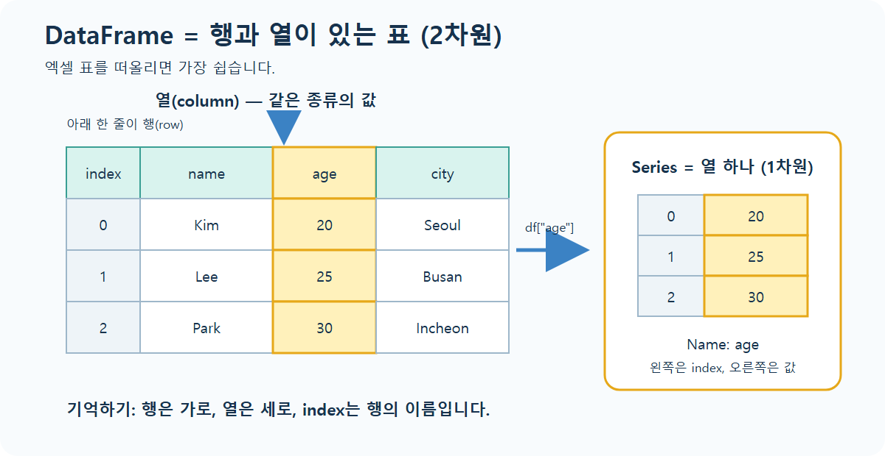
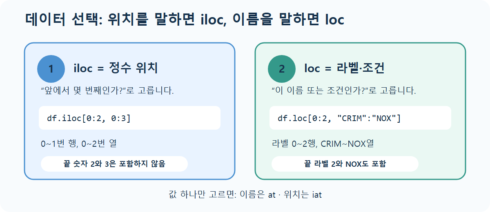

# lec01 - DataFrame 기초

[전체 목차](./README.md) · [왕초보 시작하기](./START_HERE.md) · [용어사전](./용어사전.md) · [원본 Notebook](../../sam/lec01_DataFrame__.ipynb) · [다음 강의](./lec02_DataFrame_활용.md)

## 오늘 이것만 기억하기

> **DataFrame은 전체 표, Series는 열 하나입니다.** 원하는 데이터를 고를 때 위치 번호는 `iloc`, 행·열 이름이나 조건은 `loc`를 사용합니다.



처음에는 위 그림만 이해해도 충분합니다. `index`는 각 행에 붙은 이름표이고, `name`, `age`, `city`는 열 이름입니다.

## 학습 목표

- Series와 DataFrame의 차이를 설명한다.
- DataFrame을 만들고 구조와 자료형을 확인한다.
- `[]`, `loc`, `iloc`, `at`, `iat`를 목적에 맞게 사용한다.
- 결측치를 찾고 채우거나 삭제한다.
- `groupby`, `concat`, `merge`로 데이터를 요약하고 결합한다.

마지막 두 항목인 `groupby`, `concat`, `merge`가 어렵다면 첫 학습에서는 건너뛰어도 됩니다. 먼저 1~5절을 익힌 뒤 돌아옵니다.

## 0. 가장 작은 표부터 만들기

아래 코드만 새 셀에 직접 입력하고 실행합니다.

```python
import pandas as pd

students = pd.DataFrame({
    "name": ["Kim", "Lee", "Park"],
    "score": [80, 95, 70],
})

students
```

이 줄을 읽는 법:

```text
pd.DataFrame(...)   → Pandas로 표를 만든다
"name": [...]      → name 열에 세 이름을 넣는다
"score": [...]     → score 열에 세 점수를 넣는다
students = ...      → 완성한 표에 students라는 이름을 붙인다
```

이제 열 하나를 꺼냅니다.

```python
students["score"]
```

`students` 표에서 `score`라고 적힌 세로 열 하나를 꺼내라는 뜻입니다.

## 1. Series와 DataFrame

- **Series**는 인덱스와 값으로 이루어진 1차원 자료구조입니다. DataFrame에서 열 하나를 고르면 보통 Series가 됩니다.
- **DataFrame**은 여러 Series가 같은 행 인덱스를 공유하는 2차원 표입니다.
- `np.nan`은 값이 없음을 나타내는 대표적인 결측값입니다. 숫자 열에 섞이면 자료형이 정수에서 실수로 바뀔 수 있습니다.

```python
import numpy as np
import pandas as pd

s = pd.Series([1, 3, 5, np.nan, 6, 8])

df = pd.DataFrame(
    [[1, 3, 5], [2, 4, 6]],
    index=["row1", "row2"],
    columns=["a", "b", "c"],
)
```

딕셔너리로 만들 때 키는 열 이름, 각 리스트는 열 데이터가 됩니다.

```python
df = pd.DataFrame({"name": ["Kim", "Lee"], "age": [20, 30]})
```

## 2. 불러오기와 구조 확인

현재 프로젝트에 실제로 존재하는 보스턴 주택 데이터는 다음과 같이 읽습니다.

```python
df = pd.read_csv("../datas/BostonHousing.csv")
df.columns = df.columns.str.upper()
```

> 원본 `lec01`의 `Boston-house-price-data.csv`는 프로젝트에 없습니다. 위 경로로 바꾸어야 실행됩니다.

데이터를 읽은 직후에는 다음 순서로 확인하는 습관이 좋습니다.

```python
df.shape          # 행 수와 열 수
df.head(3)        # 앞 3행
df.tail(3)        # 뒤 3행
df.columns        # 열 이름
df.index          # 행 라벨
df.dtypes         # 열별 자료형
df.info()         # 행 수, 결측이 아닌 값 수, 자료형, 메모리 요약
df.describe()     # 수치 열의 개수, 평균, 표준편차, 사분위수
```

### 보스턴 데이터 열 의미

| 열 | 의미 |
|---|---|
| `CRIM` | 지역별 1인당 범죄율 |
| `ZN` | 대형 주거용 토지 비율 |
| `INDUS` | 비소매 상업지역 토지 비율 |
| `CHAS` | 찰스강 인접 여부(1/0) |
| `NOX` | 질소산화물 농도 |
| `RM` | 주택당 평균 방 수 |
| `AGE` | 1940년 이전 건축 주택 비율 |
| `DIS` | 주요 고용센터까지의 가중 거리 |
| `RAD` | 방사형 고속도로 접근성 지수 |
| `TAX` | 재산세율 |
| `PTRATIO` | 학생/교사 비율 |
| `B` | 원 데이터가 정의한 인구 구성 관련 변환 변수 |
| `LSTAT` | 낮은 사회경제적 지위 인구 비율 |
| `MEDV` | 주택 가격 중앙값(단위: 천 달러) |

## 3. 데이터 선택



선택 문법이 헷갈리면 다음 한 문장으로 결정합니다.

```text
“앞에서 몇 번째?”라고 생각했으면 iloc
“이름이 무엇인가? 조건에 맞는가?”라고 생각했으면 loc
```

### 대괄호 `[]`

```python
df["CRIM"]                 # 열 하나 → Series
df[["CRIM", "MEDV"]]     # 열 여러 개 → DataFrame
df[0:2]                    # 위치 기준 앞 2행
```

열 하나와 여러 개를 고를 때 대괄호 개수와 반환형이 다릅니다. 후속 코드가 Series 메서드를 기대하는지 DataFrame을 기대하는지 확인합니다.

### `iloc`: 정수 위치

```python
df.iloc[0:2, 0:3]          # 0~1번 행, 0~2번 열
df.iloc[[0, 2, 4], [0, 1, -1]]
```

일반 Python 슬라이스처럼 끝 위치는 포함하지 않습니다. `-1`은 마지막 열입니다.

`df.iloc[행, 열]` 순서입니다. 쉼표 왼쪽은 행, 오른쪽은 열입니다.

### `loc`: 라벨

```python
df.loc[2:3, "INDUS":"NOX"]
df.loc[[0, 2, 4], ["CRIM", "ZN", "MEDV"]]
```

라벨 슬라이스는 시작과 끝 라벨을 **모두 포함**합니다. 인덱스가 정수처럼 보여도 `loc`은 위치가 아니라 인덱스 라벨을 찾습니다.

조건으로 고를 때는 가장 자주 다음 형태를 사용합니다.

```python
students.loc[students["score"] >= 80, ["name", "score"]]
```

안쪽부터 읽으면 “점수가 80 이상인지 확인하고 → 맞는 행에서 → 이름과 점수 열을 보여 준다”는 뜻입니다.

### `at`, `iat`: 단일값

```python
df.at[0, "ZN"]             # 행 라벨 + 열 라벨
df.iat[0, 1]               # 행 위치 + 열 위치
```

값 하나만 읽거나 쓸 때 의도가 가장 분명합니다.

| 목적 | 추천 |
|---|---|
| 열 하나/여러 개 | `df["col"]`, `df[[...]]` |
| 위치 기반 행·열 범위 | `df.iloc[...]` |
| 라벨 또는 조건 기반 행·열 | `df.loc[...]` |
| 단일값 | `df.at[...]`, `df.iat[...]` |

## 4. 열 연산과 파생 열

Pandas의 산술은 행 인덱스를 맞춰 원소별로 수행됩니다.

```python
df2["a"] + 10
df2["sum_ab"] = df2["a"] + df2["b"]
```

어느 한쪽이 `NaN`이면 산술 결과도 일반적으로 `NaN`입니다. 계산 전에 결측 처리 기준을 정해야 합니다.

## 5. 결측 데이터

결측값은 시험 답안을 안 쓴 빈칸과 같습니다. 빈칸을 0점으로 볼지, 평균으로 채울지, 그 사람의 행을 뺄지는 데이터의 의미에 따라 결정합니다.

### 찾기

```python
df.isna()             # 각 셀이 결측인지 True/False
df.isna().sum()       # 열별 결측 개수
```

### 채우기

```python
df["COMM"] = df["COMM"].fillna(0)
```

0, 평균, 중앙값, 최빈값 중 무엇으로 채울지는 데이터의 의미로 결정합니다. 결측이 곧 0이라는 업무 규칙이 없으면 무조건 0을 넣지 않습니다.

### 삭제하기

```python
df.dropna(axis=0)                    # 결측이 있는 행 삭제
df.dropna(axis=1)                    # 결측이 있는 열 삭제
df.dropna(subset=["important_col"]) # 특정 열이 결측인 행만 삭제
df.drop(columns=["unused_col"])     # 지정 열 삭제
```

기본적으로 새 DataFrame을 반환하므로 `df = df.dropna(...)`처럼 다시 대입합니다. 삭제 전후 `shape`를 비교해 손실 규모를 확인합니다.

## 6. 통계와 그룹 집계

```python
df["RAD"].value_counts()                  # 값별 빈도
df77.groupby("A")["D"].min()             # 그룹별 최솟값
df77.groupby("A")["D"].agg(["min", "max"])
df77.groupby("A").agg({"D": "min", "E": "max"})
```

`groupby`는 다음 세 단계로 읽습니다.

1. `groupby("A")`: A 값이 같은 행끼리 묶는다.
2. `["D"]`: D 열을 계산 대상으로 고른다.
3. `.agg(...)`: 각 그룹에 집계 함수를 적용한다.

여러 그룹 기준은 `groupby(["DEPTNO", "JOB"])`, 결과를 일반 DataFrame으로 돌리고 싶으면 `.reset_index()`를 사용합니다.

## 7. `concat`과 `merge`

### `concat`: 축 방향으로 이어 붙이기

```python
vertical = pd.concat([dfa, dfb], axis=0, ignore_index=True)
horizontal = pd.concat([dfa, dfb], axis=1)
```

- `axis=0`: 같은 종류의 행을 아래로 추가합니다.
- `axis=1`: 인덱스를 맞춰 열을 옆으로 추가합니다.
- 열 이름 또는 인덱스가 다르면 맞지 않는 자리는 `NaN`이 됩니다.

### `merge`: 키 관계로 결합하기

```python
pd.merge(left, right, on="key", how="inner")
pd.merge(left, right, on="key", how="outer")
pd.merge(dfa, dfb, left_index=True, right_index=True, how="inner")
```

| `how` | 남기는 키 |
|---|---|
| `inner` | 양쪽에 모두 있는 키 |
| `left` | 왼쪽의 모든 키 |
| `right` | 오른쪽의 모든 키 |
| `outer` | 양쪽 키의 합집합 |

단순히 위아래/좌우로 붙이면 `concat`, 사원-부서처럼 키의 관계로 연결하면 `merge`입니다.

## 핵심 체크리스트

- DataFrame에서 행과 열을 그림으로 가리킬 수 있나요?
- `df["A"]`는 A 열 하나를 꺼내는 코드라고 읽을 수 있나요?
- 숫자 위치는 `iloc`, 이름과 조건은 `loc`라고 구분할 수 있나요?
- `NaN`이 비어 있는 값이라는 것을 아나요?

앞의 세 질문에 답하면 [lec02](./lec02_DataFrame_활용.md)로 넘어갑니다. `groupby`와 `merge`는 lec02 실습에서 다시 만납니다.
