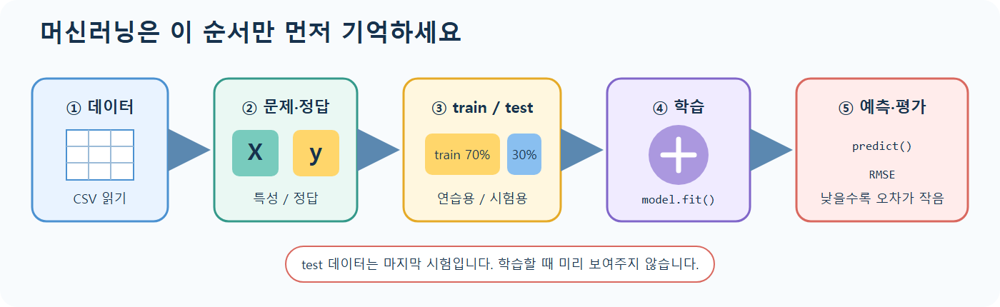

# lec04 - 머신러닝 기초

[이전 강의](./lec03_컴프리헨션과_람다.md) · [전체 목차](./README.md) · [용어사전](./용어사전.md) · [원본 Notebook](../../sam/lec04_머신러닝기초__.ipynb) · [다음 강의](./lec05_머신러닝_전처리_가공.md)

## 오늘 이것만 기억하기

> 모델은 train 데이터로 연습하고, 한 번도 보지 않은 test 데이터로 마지막 시험을 봅니다.



머신러닝이 어려워 보여도 수업 코드는 위 그림의 다섯 칸을 그대로 따라갑니다.

## 학습 목표

- 지도학습과 비지도학습을 구분한다.
- 분류, 회귀, 군집의 출력 차이를 설명한다.
- 특성 `X`와 정답 `y`를 분리하고 train/test로 나눈다.
- 선형회귀 모델을 학습하고 예측한다.
- MSE와 RMSE로 회귀 오차를 평가한다.

## 1. 머신러닝 문제 유형

### 학습 방식

| 방식 | 정답 라벨 | 목표 | 예 |
|---|---|---|---|
| 지도학습 | 있음 | 입력에서 정답을 예측 | 주택 가격, 스팸 여부 |
| 비지도학습 | 없음 | 데이터 안의 구조 발견 | 고객 군집, 차원 축소 |

### 대표 과제

- **분류(Classification)**: 범주를 예측합니다. 예: 정상/불량, 고양이/개.
- **회귀(Regression)**: 연속적인 수치를 예측합니다. 예: 가격, 온도.
- **군집(Clustering)**: 정답 없이 비슷한 관측치를 그룹으로 묶습니다.

보스턴 데이터의 `MEDV`는 연속적인 주택 가격이므로 이 수업은 지도학습 중 **회귀** 문제입니다.

처음에는 다음 두 가지만 구분합니다.

```text
“고양이인가 개인가?”처럼 종류를 맞힘 → 분류
“가격이 얼마인가?”처럼 숫자를 맞힘   → 회귀
```

## 2. 특성 `X`와 타깃 `y`

```python
import numpy as np
import pandas as pd

df = pd.read_csv("../datas/BostonHousing.csv")
df.columns = df.columns.str.upper()

X = df.drop(columns=["MEDV"])
y = df["MEDV"]
```

- `X`: 모델이 문제를 풀 때 보는 입력 특성. 여기서는 `CRIM`부터 `LSTAT`까지 13개 열입니다.
- `y`: 모델이 맞혀야 하는 정답. 여기서는 `MEDV`입니다.

타깃을 `X`에 남기면 모델이 정답을 입력으로 보게 되므로 심각한 **데이터 누수**가 발생합니다.

## 3. train/test 분리

```python
from sklearn.model_selection import train_test_split

X_train, X_test, y_train, y_test = train_test_split(
    X,
    y,
    test_size=0.3,
    random_state=1234,
)
```

- train 70%: 모델이 규칙을 학습합니다.
- test 30%: 학습 후 처음 보는 데이터로 일반화 성능을 확인합니다.
- `random_state`: 무작위 분할 결과를 재현합니다.
- 네 반환값의 행은 각각 `X_train↔y_train`, `X_test↔y_test`끼리 대응합니다.

학교 시험으로 비유하면 train은 연습 문제와 정답, test는 시험 문제와 정답입니다. 모델에는 test의 문제만 주고 예측하게 한 뒤, 우리가 가진 test 정답과 비교합니다.

모델 선택이나 전처리 결정을 test 결과를 계속 보며 바꾸면 test 데이터에도 간접적으로 맞춰집니다. 실제 프로젝트에서는 train 안에서 validation 또는 교차검증을 사용하고 test는 마지막에 평가합니다.

## 4. 선형회귀

선형회귀는 각 특성에 가중치를 곱해 더한 값으로 타깃을 예측합니다.

```text
예측값 = 절편 + w₁×CRIM + w₂×ZN + ... + w₁₃×LSTAT
```

```python
from sklearn.linear_model import LinearRegression

model = LinearRegression()
model.fit(X_train, y_train)
pred = model.predict(X_test)
```

- 생성: 사용할 모델과 설정을 준비합니다.
- `fit`: train 데이터에서 계수와 절편을 학습합니다.
- `predict`: 학습된 규칙으로 새 `X`의 값을 예측합니다.

`fit`에는 train만, 최종 평가는 test만 사용한다는 경계를 지켜야 합니다.

## 5. MSE와 RMSE

각 오차는 `실제값 - 예측값`입니다.

```text
MSE  = 오차 제곱의 평균
RMSE = √MSE
```

```python
from sklearn.metrics import mean_squared_error

mse = mean_squared_error(y_test, pred)
rmse = np.sqrt(mse)

print(f"MSE : {mse:.4f}")
print(f"RMSE: {rmse:.4f}")
```

- 오차를 제곱하므로 큰 오차에 더 큰 벌점을 줍니다.
- RMSE는 `MEDV`와 같은 단위인 “천 달러”로 해석할 수 있습니다.
- 낮을수록 좋지만, 의미 있는지 판단하려면 단순 평균 예측 같은 기준 모델과 비교하는 것이 좋습니다.

원본 Notebook은 `np.sqrt(mse)`를 출력하므로 실제 출력값은 MSE가 아니라 **RMSE**입니다.

## 6. 전체 실행 코드

```python
import numpy as np
import pandas as pd
from sklearn.linear_model import LinearRegression
from sklearn.metrics import mean_squared_error
from sklearn.model_selection import train_test_split

df = pd.read_csv("../datas/BostonHousing.csv")
df.columns = df.columns.str.upper()

X = df.drop(columns="MEDV")
y = df["MEDV"]

X_train, X_test, y_train, y_test = train_test_split(
    X, y, test_size=0.3, random_state=1234
)

model = LinearRegression()
model.fit(X_train, y_train)

pred = model.predict(X_test)
rmse = mean_squared_error(y_test, pred) ** 0.5
print(f"RMSE: {rmse:.4f}")
```

## 핵심 체크리스트

- `X`는 힌트, `y`는 정답이라고 설명할 수 있나요?
- train은 연습용, test는 마지막 시험용이라고 구분할 수 있나요?
- `fit → predict → 평가` 순서를 말할 수 있나요?
- RMSE가 낮을수록 예측 오차가 작다는 것을 아나요?
