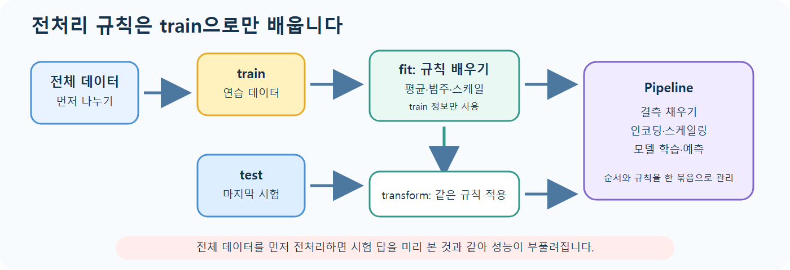
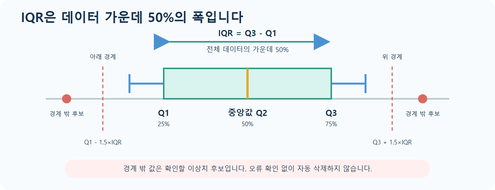
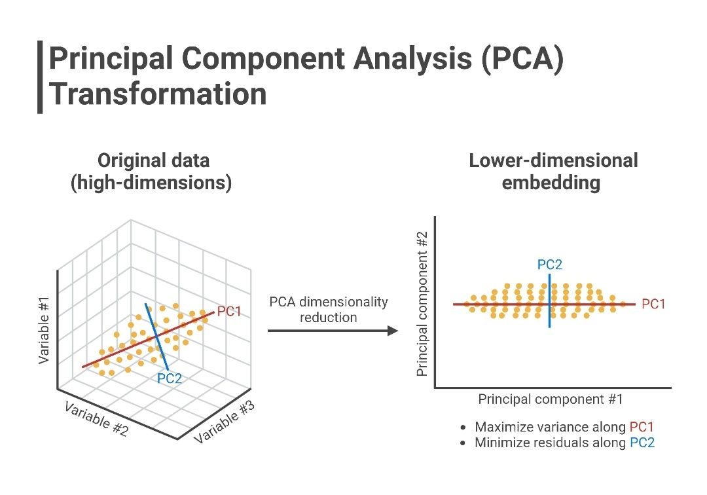
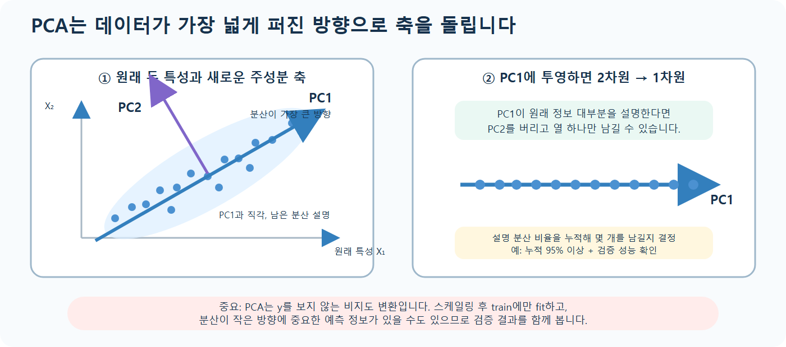

# lec05 - 머신러닝 전처리·가공

[이전 강의](./lec04_머신러닝_기초.md) · [전체 목차](./README.md) · [용어사전](./용어사전.md) · [원본 Notebook](../../sam/lec05_머신러닝_전처리가공__.ipynb) · [다음 강의](./lec06_Matplotlib.md)

> 이 문서는 2026-08-27에 업데이트된 Notebook 77개 셀을 다시 분석해 반영했습니다.

## 오늘 이것만 기억하기

> 데이터를 그래프로 먼저 이해하고, **train 데이터로만** 전처리 규칙을 배운 뒤 같은 규칙을 test 데이터에 적용합니다.



전처리는 요리 전 재료 손질과 비슷합니다. 빈칸을 처리하고, 너무 특이한 값을 확인하고, 숫자 범위를 맞춘 뒤 모델에 넣습니다. 다만 test 데이터는 마지막 시험이므로 손질 기준을 정할 때 미리 보면 안 됩니다.

## 업데이트된 수업 흐름

이번 Notebook에는 다음 실습이 추가되었습니다.

```text
데이터 읽기
  → 기준 선형회귀 점수 측정
  → EDA와 상관분석
  → 결측 처리와 범주형 인코딩 이론
  → 이상치 탐색·시각화·삭제 실습
  → 왜도와 첨도
  → 로그 변환
  → Standard/MinMax/Robust 스케일링
  → 파생 특성
  → PCA 차원 축소
```

## 1. 데이터와 기준 점수

### 데이터 읽기

```python
import numpy as np
import pandas as pd
import matplotlib.pyplot as plt
import seaborn as sns

from sklearn.decomposition import PCA
from sklearn.linear_model import LinearRegression
from sklearn.metrics import mean_squared_error
from sklearn.model_selection import train_test_split
from sklearn.preprocessing import MinMaxScaler, RobustScaler, StandardScaler

df = pd.read_csv("../datas/BostonHousing.csv")
df.columns = df.columns.str.upper()
```

이 데이터는 506개 지역과 14개 열을 가집니다. `MEDV`가 맞혀야 할 주택 가격이고, 나머지 13개 열이 문제를 풀 때 보는 특성입니다.

```python
X = df.drop(columns="MEDV")
y = df["MEDV"]

X_train, X_test, y_train, y_test = train_test_split(
    X,
    y,
    test_size=0.3,
    random_state=1234,
)
```

| 데이터 | 모양 | 뜻 |
|---|---:|---|
| `X_train` | `(354, 13)` | 연습 문제 354개 |
| `X_test` | `(152, 13)` | 시험 문제 152개 |
| `y_train` | `(354,)` | 연습 문제 정답 |
| `y_test` | `(152,)` | 시험 문제 정답 |

### 기준 모델과 RMSE

```python
def rmse_score(X_train, y_train, X_test, y_test):
    model = LinearRegression()
    model.fit(X_train, y_train)
    pred = model.predict(X_test)
    return mean_squared_error(y_test, pred) ** 0.5

baseline_rmse = rmse_score(X_train, y_train, X_test, y_test)
print(f"RMSE: {baseline_rmse:.4f}")
```

Notebook의 기준 결과는 `4.9105`입니다. 원본 함수는 `mse`라고 출력하지만 제곱근을 계산했으므로 실제 지표 이름은 **RMSE**입니다.

전처리 전후 결과는 같은 train/test 분할과 같은 지표로 비교해야 합니다.

### 이론 보충: RMSE가 측정하는 것

각 데이터의 오차를 `실제값 - 예측값`이라고 하면 RMSE는 다음 순서로 계산합니다.

```text
오차 eᵢ      = yᵢ - 예측값ᵢ
MSE          = (e₁² + e₂² + ... + eₙ²) / n
RMSE         = √MSE
```

- 오차를 제곱하므로 큰 오차에 더 큰 벌점을 줍니다.
- 마지막에 제곱근을 취하므로 결과 단위가 타깃과 같습니다. `MEDV`의 단위가 천 달러라면 RMSE도 천 달러 단위입니다.
- 이상치 하나의 큰 오차가 전체 RMSE를 크게 올릴 수 있습니다.
- 서로 다른 데이터나 타깃 단위의 RMSE 숫자를 그대로 비교할 수 없습니다.

RMSE만으로 모델 전체를 판단하지 않습니다. 큰 오차에 덜 민감한 MAE, 평균 대비 설명력을 보는 R², 잔차 그래프를 함께 보면 좋습니다. 또한 한 번의 train/test 분할 결과는 우연에 따라 달라질 수 있으므로 최종 판단에는 교차검증을 사용합니다.

## 2. EDA: 모델보다 먼저 데이터를 살펴보기

EDA는 Exploratory Data Analysis의 약자로 **탐색적 데이터 분석**입니다. 모델을 만들기 전에 데이터의 모양, 분포, 관계, 이상한 값을 살펴보는 과정입니다.

### 열별 분포

```python
df.hist(figsize=(16, 10))
plt.tight_layout()
plt.show()
```

히스토그램에서 확인할 내용:

- 값이 가운데에 모이는가, 한쪽으로 치우치는가?
- 대부분 0인 열이 있는가?
- 값의 범위가 열마다 얼마나 다른가?
- 다른 값과 멀리 떨어진 값이 보이는가?

### 요약 통계

```python
stat_df = df.describe()
stat_df
```

| 행 | 뜻 |
|---|---|
| `count` | 비어 있지 않은 값의 수 |
| `mean` | 평균 |
| `std` | 표준편차, 값이 퍼진 정도 |
| `min`, `max` | 최솟값과 최댓값 |
| `25%`, `50%`, `75%` | Q1, 중앙값, Q3 |

Notebook의 `stat_df.iloc[1, :]`는 두 번째 행인 모든 열의 평균을 배열로 꺼냅니다.

## 3. 상관분석

상관계수는 두 숫자가 함께 움직이는 방향과 정도를 `-1`부터 `1` 사이로 표현합니다.

```python
correlation = df.corr(numeric_only=True)

plt.figure(figsize=(12, 6))
sns.heatmap(correlation, annot=True, fmt=".2f", cmap="Blues")
plt.show()
```

이번 데이터의 대표 관계:

| 두 열 | 상관계수 | 쉬운 해석 |
|---|---:|---|
| `RM` ↔ `MEDV` | 약 `+0.70` | 방 수가 많을수록 가격이 높은 경향 |
| `LSTAT` ↔ `MEDV` | 약 `-0.74` | LSTAT이 높을수록 가격이 낮은 경향 |
| `RAD` ↔ `TAX` | 약 `+0.91` | 두 입력 특성이 매우 비슷하게 움직임 |

`RAD`와 `TAX`처럼 입력 특성끼리 상관이 너무 강하면 선형회귀 계수가 불안정해지는 **다중공선성**을 의심할 수 있습니다.

> 상관관계는 원인과 결과를 증명하지 않습니다. 그래프와 업무 지식을 함께 확인해야 합니다.

### 이론 보충: Pearson 상관계수

Pandas의 `corr()` 기본값은 Pearson 상관계수입니다.

```text
r = 두 변수의 공분산 / (X의 표준편차 × Y의 표준편차)
```

- `r = +1`: 완전한 양의 **선형** 관계
- `r = -1`: 완전한 음의 **선형** 관계
- `r ≈ 0`: 선형 관계가 약함. 곡선 관계까지 없다는 뜻은 아닙니다.

Pearson 상관계수의 한계:

1. 직선 형태의 관계만 잘 포착합니다.
2. 이상치 몇 개에 크게 변할 수 있으므로 산점도를 같이 봅니다.
3. 두 변수가 같은 원인의 영향을 받아 함께 움직여도 상관이 높게 나옵니다.
4. 상관계수가 높아도 인과관계를 뜻하지 않습니다.

### 이론 보충: 다중공선성

다중공선성은 한 입력 특성을 다른 입력 특성들로 거의 설명할 수 있는 상태입니다. 예를 들어 `RAD`와 `TAX`가 매우 비슷하게 움직이면 선형회귀가 둘의 효과를 따로 나누기 어려워집니다.

- 전체 예측은 괜찮아도 개별 회귀계수의 크기와 부호가 데이터 변화에 따라 흔들릴 수 있습니다.
- “TAX가 1 증가할 때 가격이 얼마나 바뀌는가?” 같은 계수 해석이 불안정해집니다.
- VIF는 `VIFⱼ = 1 / (1 - Rⱼ²)`로 계산하며, 한 특성을 나머지 특성으로 얼마나 잘 설명하는지 확인합니다. 5 또는 10 같은 기준은 참고값일 뿐 절대 규칙은 아닙니다.

대응 방법은 업무적으로 중복된 열 제거, Ridge 같은 규제 모델, PCA, 데이터 추가 등이 있습니다. 상관이 높다는 이유만으로 무조건 열을 삭제하지 않고 예측 목적과 해석 목적을 구분합니다.

## 4. 결측 처리와 범주형 인코딩

업데이트된 Notebook에서는 개념만 언급하고 실제 코드는 실행하지 않지만, 대부분의 실전 데이터에서 먼저 필요한 전처리입니다.

### 4.1 결측값

결측값은 단순히 비어 있는 칸이 아닙니다. 왜 값이 비었는지가 중요합니다.

| 유형 | 쉬운 설명 | 예 |
|---|---|---|
| MCAR | 다른 정보와 상관없이 우연히 비어 있음 | 무작위 센서 전송 실패 |
| MAR | 관측된 다른 열과 관련되어 비어 있음 | 연령대에 따라 응답 누락 차이 |
| MNAR | 비어 있는 값 자체와 관련되어 누락 | 소득이 높은 사람이 소득 응답 거부 |

평균·중앙값으로 채우면 행은 보존되지만 분포가 인위적으로 가운데에 모이고 열 사이 관계가 약해질 수 있습니다. 결측 자체가 정보를 가질 때는 결측 여부 열을 함께 만들기도 합니다.

```python
from sklearn.impute import SimpleImputer

imputer = SimpleImputer(
    strategy="median",
    add_indicator=True,
)

X_train_imputed = imputer.fit_transform(X_train)
X_test_imputed = imputer.transform(X_test)
```

중앙값도 train에서만 계산합니다. test까지 포함해 중앙값을 구하면 전처리 누수입니다.

### 4.2 범주형 인코딩

모델이 바로 처리하지 못하는 글자 범주를 숫자 배열로 바꿉니다.

| 범주 종류 | 예 | 일반적인 방법 |
|---|---|---|
| 명목형 | 서울, 부산, 인천 | One-Hot Encoding |
| 순서형 | 하, 중, 상 | 순서를 명시한 Ordinal Encoding |

명목형에 서울=1, 부산=2, 인천=3처럼 숫자를 주면 모델이 인천이 서울보다 3배 크다는 가짜 관계를 배울 수 있습니다.

```python
from sklearn.preprocessing import OneHotEncoder

train_city_df = pd.DataFrame({"CITY": ["서울", "부산", "서울"]})
test_city_df = pd.DataFrame({"CITY": ["인천"]})

encoder = OneHotEncoder(handle_unknown="ignore")
encoder.fit(train_city_df[["CITY"]])

train_city = encoder.transform(train_city_df[["CITY"]])
test_city = encoder.transform(test_city_df[["CITY"]])
```

`handle_unknown="ignore"`는 train에 없던 새 범주가 test나 실제 서비스에 나와도 오류 대신 모든 범주 열을 0으로 처리합니다. BostonHousing 데이터는 모든 열이 이미 숫자이며 `CHAS`도 0/1로 표현되어 있어 이 Notebook에서는 별도 인코딩을 실행하지 않습니다.

## 5. 이상치 탐색

이상치는 다른 값에서 멀리 떨어진 관측치입니다. **이상치가 곧 잘못된 데이터라는 뜻은 아닙니다.** 입력 오류인지, 실제로 드문 사례인지 먼저 확인합니다.

### 5.1 평균 ± 3표준편차

`RM`의 평균은 약 `6.2846`, 표준편차는 약 `0.7026`입니다.

```python
mean_rm = df["RM"].mean()
std_rm = df["RM"].std()

lower_3s = mean_rm - 3 * std_rm
upper_3s = mean_rm + 3 * std_rm

sigma_outliers = df.loc[
    (df["RM"] < lower_3s) | (df["RM"] > upper_3s),
    "RM",
]
```

경계는 약 `4.1768`과 `8.3925`입니다. 양쪽 경계를 모두 적용하면 아래쪽 4개, 위쪽 4개가 후보가 됩니다. 원본 Notebook 출력은 위쪽 경계를 넘는 4개만 조회합니다.

이 방법은 분포가 정규분포와 비슷할 때 해석하기 쉽고, 평균과 표준편차 자체가 이상치의 영향을 받는다는 단점이 있습니다.

### 5.2 IQR

IQR은 데이터 가운데 50%의 범위입니다.



```python
q1 = df["RM"].quantile(0.25)
q3 = df["RM"].quantile(0.75)
iqr = q3 - q1

lower_iqr = q1 - 1.5 * iqr
upper_iqr = q3 + 1.5 * iqr

iqr_outliers = df.loc[
    (df["RM"] < lower_iqr) | (df["RM"] > upper_iqr),
    "RM",
]
```

이번 데이터의 결과:

```text
Q1          = 5.8855
Q3          = 6.6235
IQR         = 0.7380
아래 경계    = 4.7785
위 경계      = 7.7305
후보 수      = 아래 8개 + 위 22개 = 30개
```

원본 Notebook은 위 경계를 넘는 22개를 출력합니다. 실제 이상치 검사는 보통 양쪽을 모두 확인합니다.

#### 이론 보충: IQR이 이상치에 강한 이유

평균과 표준편차는 모든 값의 크기를 사용하기 때문에 극단값 하나에도 움직입니다. 반면 Q1과 Q3는 정렬된 데이터에서 25%, 75% 위치를 보기 때문에 아주 큰 값 몇 개의 영향을 상대적으로 적게 받습니다. 이런 통계를 **강건하다(robust)**고 표현합니다.

`1.5 × IQR`은 John Tukey가 박스플롯을 위해 제안한 관례적인 탐색 기준입니다. 자연 법칙이나 “이 경계 밖은 오류”라는 판정식이 아닙니다.

- 정규분포라면 IQR 경계는 대략 평균의 `±2.7 표준편차` 부근입니다.
- 표본이 작거나 분포가 심하게 치우치면 정상값도 많이 경계 밖에 놓일 수 있습니다.
- Python, Excel, 통계 프로그램은 사분위수 보간 방식이 조금씩 달라 경계값이 미세하게 다를 수 있습니다.
- 박스플롯 수염 끝은 보통 **경계 자체**가 아니라 경계 안에 있는 실제 관측값 중 가장 끝값입니다.

#### 평균 ± 3표준편차와 IQR 비교

| 기준 | 핵심 가정 | 장점 | 약점 |
|---|---|---|---|
| 평균 ± 3표준편차 | 분포가 정규분포와 비슷함 | 평균과 표준편차로 쉽게 계산 | 극단값과 비대칭 분포에 민감 |
| 1.5 × IQR | 특별한 분포 가정이 적음 | 이상치와 비대칭에 비교적 강함 | 작은 표본·긴 꼬리에서 후보가 많을 수 있음 |

어느 방법이 항상 우월한 것은 아닙니다. 분포 그림, 데이터 생성 과정, 업무 기준을 함께 사용합니다.

### 5.3 그림으로 확인

```python
fig, axes = plt.subplots(2, 2, figsize=(10, 6))

sns.scatterplot(data=df, x="RM", y="MEDV", ax=axes[0, 0])
sns.scatterplot(data=df, x="LSTAT", y="MEDV", ax=axes[0, 1])
sns.boxplot(data=df, x="RM", ax=axes[1, 0])
sns.boxplot(data=df, x="LSTAT", ax=axes[1, 1])

plt.tight_layout()
plt.show()
```

- 산점도는 특성과 가격의 관계 속에서 특이한 점을 찾습니다.
- 박스플롯은 IQR 경계 밖의 후보를 점으로 보여 줍니다.
- 통계 기준 한 가지만 보고 바로 삭제하지 않습니다.

## 6. Notebook의 이상치 삭제 실습 해석

Notebook은 다음 조건으로 364번 행을 찾습니다.

```python
suspicious = df.loc[(df["RM"] > 8) & (df["MEDV"] < 30)]
```

해당 행은 `RM=8.78`, `MEDV=21.9`입니다. 이를 삭제하면 행 수가 `506 → 505`가 되고, Notebook의 출력 RMSE는 `4.9105 → 4.4170`으로 내려갑니다.

하지만 이 결과만 보고 삭제가 옳다고 결론 내리면 안 됩니다.

1. 삭제 조건을 만들 때 정답인 `MEDV`를 사용했습니다.
2. train/test를 나누기 전에 전체 데이터에서 행을 골랐습니다.
3. 행이 사라져 train/test 구성 자체가 달라졌으므로 기준 점수와 완전히 같은 시험이 아닙니다.
4. 실제로 방이 많지만 가격이 낮은 중요한 사례일 수도 있습니다.

실전에서는 입력 오류나 명확한 업무 규칙이 확인된 경우에만 삭제합니다. 통계 기준을 학습해야 한다면 train에서 기준을 만들고 test 데이터는 원래 상태로 평가합니다.

```python
# 예: 정답 y를 보지 않고 train의 RM 분포로만 경계 만들기
q1 = X_train["RM"].quantile(0.25)
q3 = X_train["RM"].quantile(0.75)
iqr = q3 - q1

train_mask = X_train["RM"].between(
    q1 - 1.5 * iqr,
    q3 + 1.5 * iqr,
)

X_train_filtered = X_train.loc[train_mask]
y_train_filtered = y_train.loc[train_mask]
```

### 이론 보충: 회귀에서 이상치의 세 종류

회귀에서는 단순히 한 열의 값이 큰지만 보는 것보다 모델과의 관계를 확인합니다.

| 종류 | 뜻 | 확인 방법 |
|---|---|---|
| y 방향 이상치 | 실제값과 예측값의 차이인 잔차가 큼 | 잔차 그래프 |
| 레버리지 점 | 입력 특성 X가 다른 행에서 멀리 떨어짐 | hat value, 특성 산점도 |
| 영향력 있는 점 | 해당 행을 빼면 회귀선이나 계수가 크게 달라짐 | Cook's distance |

레버리지가 높은 점도 회귀 추세와 잘 맞으면 문제가 아닐 수 있고, 잔차가 큰 점도 실제 중요한 희귀 사례일 수 있습니다. 삭제 외에도 다음 선택이 있습니다.

- 원본 데이터 입력 오류 수정
- 상·하한으로 값을 제한하는 winsorization
- 로그 또는 제곱근 변환
- `RobustScaler`, HuberRegressor, 트리 모델처럼 이상치에 덜 민감한 방법
- 별도 그룹이나 이상 현상으로 분석

삭제 여부와 기준은 코드, 데이터 사전, 실험 기록에 남겨 재현할 수 있게 합니다.

## 7. 왜도와 첨도

### 왜도(Skewness)

왜도는 분포가 어느 쪽으로 기울었는지 나타냅니다.

| 값 | 모양 |
|---:|---|
| `0` 근처 | 좌우가 비슷함 |
| 양수 | 오른쪽 꼬리가 김 |
| 음수 | 왼쪽 꼬리가 김 |

### 첨도(Kurtosis)

첨도는 분포의 꼬리가 얼마나 두껍고 극단값이 나타나기 쉬운지를 보여 줍니다.

```python
df.skew(numeric_only=True)
df.kurt(numeric_only=True)
```

> **Pandas 기준:** `DataFrame.kurt()`는 Fisher의 초과 첨도를 사용하므로 정규분포 기준이 `0`입니다. 일부 통계 설명에서 사용하는 Pearson 첨도는 정규분포 기준이 `3`이므로 기준을 섞지 않습니다.

Notebook에서 364번 행을 삭제한 뒤 `MEDV`의 왜도는 약 `1.11`, Pandas 첨도는 약 `1.49`로 나옵니다. 오른쪽 꼬리와 정규분포보다 두꺼운 꼬리를 가진다는 신호입니다.

### 이론 보충: 분포와 선형회귀 가정

자주 생기는 오해는 “모든 입력 특성이 정규분포여야 선형회귀를 쓸 수 있다”는 주장입니다. 일반 선형회귀는 입력 X 자체가 정규분포일 것을 요구하지 않습니다.

선형회귀에서 주로 확인하는 내용은 다음과 같습니다.

- X와 y 관계가 충분히 선형인가?
- 잔차의 분산이 예측 구간 전체에서 비슷한가? — 등분산성
- 행의 오차가 서로 독립적인가?
- 통계적 유의성·신뢰구간을 해석할 때 잔차가 정규분포와 비슷한가?

왜도와 첨도는 분포를 빠르게 요약하는 신호이지 자동 변환 명령이 아닙니다. `CHAS`처럼 0/1인 이진 열은 원래 비대칭일 수 있으므로 정규분포로 만들려고 하지 않습니다. 표본 첨도는 극단값과 표본 크기에 민감하므로 히스토그램, Q-Q plot, 업무 의미를 함께 봅니다.

## 8. 로그 변환

로그는 큰 양수를 압축해 오른쪽으로 긴 꼬리를 완화할 때 사용할 수 있습니다.

```python
np.log(1000)                 # 약 6.9078
np.exp(np.log(1000))         # 다시 약 1000
```

원본 Notebook의 그래프 제목 계산은 다음처럼 고쳐야 합니다.

```python
log_medv = np.log(df["MEDV"])

fig, axes = plt.subplots(1, 2, figsize=(10, 3))

df["MEDV"].hist(ax=axes[0])
axes[0].set_title(
    f"원본: skew={df['MEDV'].skew():.2f}, kurt={df['MEDV'].kurt():.2f}"
)

log_medv.hist(ax=axes[1])
axes[1].set_title(
    f"로그: skew={log_medv.skew():.2f}, kurt={log_medv.kurt():.2f}"
)

plt.tight_layout()
plt.show()
```

원본 코드의 `np.log(df['MEDV'].skew())`는 **분포를 로그 변환한 뒤 왜도를 구하는 것**이 아니라 왜도 숫자 하나에 로그를 취한 값입니다.

주의할 점:

- 일반 `np.log`는 0과 음수에 바로 적용할 수 없습니다.
- 0을 포함한 양수 데이터에는 상황에 따라 `np.log1p(x)`를 사용합니다.
- 회귀 타깃 로그 변환은 필수가 아닙니다. 분포, 잔차, 평가 지표와 문제 목적을 보고 결정합니다.
- 타깃을 로그로 학습했다면 예측값은 `np.exp` 또는 `np.expm1`로 원래 단위에 되돌려 평가합니다.

### 이론 보충: 로그가 모델에 주는 의미

로그의 중요한 성질은 곱셈을 덧셈으로 바꾸는 것입니다.

```text
log(a × b) = log(a) + log(b)
log(a / b) = log(a) - log(b)
```

따라서 값이 일정한 양만큼 증가하는 관계보다 일정한 **비율**로 증가하는 관계에서 유용합니다. 예를 들어 가격이 매번 10만 원씩 늘어나는 것이 아니라 10%씩 늘어나는 현상을 더 선형에 가깝게 만들 수 있습니다.

타깃 `y`에 로그를 적용하면 모델이 원래 가격 차이보다 비율 차이를 더 비슷하게 다루게 됩니다. 이것은 단순한 모양 변경이 아니라 최적화하는 오류의 의미를 바꾸는 선택입니다.

또한 `exp(평균 로그 예측)`은 일반적으로 원래 값의 평균과 정확히 같지 않습니다. 이를 재변환 편향이라고 하며, 평균 가격을 정확히 예측해야 하는 문제에서는 별도의 보정이나 원 단위 검증이 필요합니다.

## 9. 스케일링

열마다 단위와 범위가 크게 다를 때 숫자 범위를 맞춥니다.

| 도구 | 변환 방식 | 적합한 상황 |
|---|---|---|
| `StandardScaler` | 평균 0, 표준편차 1 | 일반적인 표준화 |
| `MinMaxScaler` | 기본 0~1 범위 | 정해진 범위가 필요할 때 |
| `RobustScaler` | 중앙값과 IQR 사용 | 이상치 영향이 큰 데이터 |

세 스케일러의 계산식은 다음과 같습니다. 모든 기준값은 train에서 계산합니다.

```text
StandardScaler : z = (x - train 평균) / train 표준편차
MinMaxScaler   : z = (x - train 최솟값) / (train 최댓값 - train 최솟값)
RobustScaler   : z = (x - train 중앙값) / train IQR
```

- StandardScaler 결과가 항상 정규분포가 되는 것은 아닙니다. 평균과 표준편차만 바뀝니다.
- MinMaxScaler의 test 값이 train 범위를 벗어나면 결과가 0보다 작거나 1보다 클 수 있습니다.
- RobustScaler도 이상치를 제거하지 않습니다. 중앙값과 IQR을 사용해 영향만 줄입니다.

Notebook은 `[175, 177, 179, 181, 183]`의 평균 `179`, 분산 `8`, 표준편차 약 `2.8284`를 직접 계산해 표준화의 기준을 확인합니다.

### 안전한 적용 순서

```python
scaler = StandardScaler()

scaler.fit(X_train)                 # train에서 평균과 표준편차 학습
X_train_scaled = scaler.transform(X_train)
X_test_scaled = scaler.transform(X_test)

scaled_rmse = rmse_score(
    X_train_scaled,
    y_train,
    X_test_scaled,
    y_test,
)
```

Notebook 결과는 스케일링 전후 모두 `4.9105`입니다. 오류가 아닙니다. 절편이 있는 일반 선형회귀는 입력을 선형 스케일링해도 같은 예측을 만들 수 있습니다. 스케일링은 거리 기반 모델, 경사하강 모델, 규제가 있는 모델, PCA에서 특히 중요합니다.

### 어떤 모델이 스케일에 민감한가?

| 스케일링이 중요한 경우 | 상대적으로 덜 민감한 경우 |
|---|---|
| KNN, K-Means처럼 거리 계산 | Decision Tree |
| SVM의 거리·마진 계산 | Random Forest |
| Ridge, Lasso처럼 계수에 규제 | 일반적인 트리 부스팅 |
| 로지스틱 회귀, 신경망의 최적화 | 규칙 기반 모델 |
| PCA의 분산 방향 계산 |  |

트리 모델도 전처리가 전혀 필요 없다는 뜻은 아닙니다. 결측, 범주형 처리, 데이터 품질 확인은 여전히 필요합니다.

## 10. 파생 특성과 타깃 누수

파생 특성은 기존 입력 열을 조합해 의미 있는 새 입력을 만드는 작업입니다.

### Notebook 코드에서 반드시 주의할 점

```python
df["TAX_RATIO"] = df["TAX"] / df["MEDV"]
```

`MEDV`는 모델이 맞혀야 하는 정답입니다. `TAX_RATIO`에 `MEDV`가 들어가면 모델 입력에 정답 정보가 섞이는 **타깃 누수**가 발생합니다.

이후 `myscore222(df)`는 `MEDV` 열만 제거하고 `TAX_RATIO`는 입력에 남기므로, Notebook에 나온 RMSE `3.9661`은 정상적인 성능 개선으로 해석할 수 없습니다.

정답을 전혀 사용하지 않는 파생 특성을 만듭니다.

```python
df_safe = df.copy()
df_safe["TAX_PER_ROOM"] = df_safe["TAX"] / df_safe["RM"]
```

좋은 파생 특성의 조건:

- 예측 시점에 실제로 알 수 있는 값만 사용합니다.
- 타깃이나 미래 정보를 포함하지 않습니다.
- 업무적으로 의미를 설명할 수 있습니다.
- 동일한 검증 과정에서 실제로 도움이 되는지 확인합니다.

### 이론 보충: 파생 특성이 필요한 이유

모델은 입력에 표현된 관계만 학습할 수 있습니다. 선형회귀에 단순한 `X₁`, `X₂`만 주면 기본적으로 각각의 독립적인 직선 효과를 배웁니다. 실제 관계를 더 잘 표현하려면 다음과 같은 특성을 만들 수 있습니다.

| 종류 | 예 | 의미 |
|---|---|---|
| 비율 | `TAX / RM` | 방 수 대비 세금 |
| 상호작용 | `RM * LSTAT` | 두 특성이 함께 변할 때의 효과 |
| 다항 특성 | `RM ** 2` | 휘어진 관계 표현 |
| 구간화 | 나이를 연령대로 변경 | 비선형 구간 효과 |
| 시간 집계 | 최근 7일 평균 | 과거 흐름 요약 |

복잡한 특성을 많이 만들수록 학습 데이터에는 잘 맞지만 새 데이터에는 약한 과적합 위험이 커집니다. 교차검증으로 효과를 확인하고, 0으로 나누기·무한대·결측 발생도 검사합니다.

누수는 타깃을 직접 넣는 경우만이 아닙니다. 예측 시점 이후에 알게 되는 값, 전체 데이터로 만든 평균, 같은 사람의 미래 기록도 입력에 들어가면 누수입니다.



## 11. PCA 차원 축소

PCA는 서로 관련된 여러 수치 특성을 새로운 축으로 바꿔 더 적은 수의 열로 요약합니다.



- 장점: 차원과 중복 정보 감소, 학습 속도 향상 가능
- 단점: 새 주성분의 업무적 의미를 설명하기 어려움
- PCA는 값의 크기에 민감하므로 보통 먼저 스케일링합니다.

### 이론 보충: PCA가 축을 찾는 과정

PCA는 다음 계산을 수행하는 비지도 학습 변환입니다.

1. 각 특성의 중심을 맞춥니다. 단위가 다르면 먼저 스케일링합니다.
2. 특성들이 함께 변하는 정도를 나타내는 공분산 행렬을 만듭니다.
3. 공분산 행렬의 고유벡터와 고유값을 구합니다.
4. 고유값이 큰 순서대로 축을 정렬합니다.
5. 선택한 축 위에 원래 데이터를 투영합니다.

```text
변환된 데이터 Z = 스케일된 X × 선택한 주성분 축 W
```

- **고유벡터**는 새로운 축의 방향이며, 각 원래 특성이 주성분에 얼마나 기여하는지를 loading으로 확인합니다.
- **고유값**은 해당 축이 설명하는 분산의 크기입니다.
- 각 주성분은 서로 직각이어서 상관이 없습니다.
- PC1은 가능한 모든 방향 중 분산을 가장 많이 보존하고, PC2는 PC1과 직각인 방향 중 남은 분산을 가장 많이 보존합니다.

설명 분산 비율은 다음 뜻입니다.

```text
PCⱼ 설명 분산 비율 = PCⱼ 고유값 / 모든 고유값의 합
누적 설명 분산      = 앞에서 선택한 비율을 차례로 더한 값
```

성분 수는 누적 설명 분산 90%, 95%, 99% 같은 기준을 참고할 수 있지만 고정 규칙은 아닙니다. 최종적으로는 검증 성능, 계산 비용, 해석 가능성을 함께 봅니다.

### PCA의 중요한 한계

1. **PCA는 y를 보지 않습니다.** 분산이 작은 방향에 타깃 예측에 중요한 정보가 있어도 버릴 수 있습니다.
2. 선형 조합만 만들므로 복잡한 비선형 구조를 그대로 펴 주지는 못합니다.
3. 스케일에 민감합니다. 단위가 큰 열이 주성분을 지배할 수 있습니다.
4. PC1, PC2는 여러 원래 열의 혼합이므로 업무적 해석이 어려워집니다.
5. 차원을 줄였다고 예측 성능이 반드시 좋아지는 것은 아닙니다. 노이즈 감소와 정보 손실이 동시에 일어납니다.

이번 Notebook의 `n_components=12`는 13개 특성을 12개로 줄이므로 차원 감소가 매우 작습니다. 여러 성분 수를 Pipeline 안에서 교차검증해 선택해야 합니다.

### Notebook 결과를 읽을 때의 주의점

원본은 `pca.fit(X)`를 전체 데이터에 실행한 다음 train/test를 나눕니다. test 데이터 정보가 PCA 축을 만드는 데 들어가므로 누수입니다. 또한 스케일링하지 않아 `TAX`, `B`처럼 분산이 큰 열이 주성분을 지배할 수 있습니다.

Notebook의 PCA RMSE `4.8682`는 실행 결과로는 맞지만, 누수 없는 공정한 비교 결과로 사용하면 안 됩니다.

### Pipeline으로 안전하게 적용

```python
from sklearn.pipeline import Pipeline

pca_model = Pipeline([
    ("scaler", StandardScaler()),
    ("pca", PCA(n_components=12)),
    ("model", LinearRegression()),
])

pca_model.fit(X_train, y_train)
pca_pred = pca_model.predict(X_test)
pca_rmse = mean_squared_error(y_test, pca_pred) ** 0.5

explained = pca_model.named_steps["pca"].explained_variance_ratio_
print(f"PCA RMSE: {pca_rmse:.4f}")
print("설명 분산 비율:", explained)
```

Pipeline 전체가 train에만 `fit`되고 test에는 저장된 변환이 적용됩니다. `n_components=12`는 13개 특성 중 하나만 줄이는 설정이므로, 성분 수는 설명 분산 누적 비율과 검증 결과를 보고 선택합니다.

## 12. Notebook 상태가 누적된다는 점

Notebook 셀은 앞에서 만든 변수 상태를 계속 사용합니다.

- 이상치 삭제 후 `df`는 505행이 됩니다.
- 이후 `TAX_RATIO`는 이 505행 `df`에 추가됩니다.
- 하지만 앞에서 만든 `X`와 `y`는 자동으로 바뀌지 않아 계속 506행입니다.
- 마지막 PCA는 최신 `df`가 아니라 예전에 만든 506행 `X`를 사용합니다.

따라서 셀을 건너뛰거나 순서를 바꿔 실행하면 결과가 달라질 수 있습니다. 혼란스러울 때는 **Kernel → Restart Kernel and Run All Cells**로 위에서 아래까지 다시 실행하고, 변환 단계마다 새 변수 이름을 사용합니다.

## 13. Notebook 실행 결과 요약

| 실험 | Notebook 출력 RMSE | 학습 자료로서의 해석 |
|---|---:|---|
| 원본 선형회귀 | `4.9105` | 기준 점수 |
| 364번 행 삭제 | `4.4170` | target 조건·분할 변경으로 직접 비교 주의 |
| StandardScaler | `4.9105` | 선형회귀에서는 같을 수 있음 |
| `TAX/MEDV` 파생 열 | `3.9661` | **타깃 누수이므로 무효** |
| 전체 X에 PCA 후 분할 | `4.8682` | PCA 누수·스케일 미적용으로 공정 비교 아님 |

점수가 낮아졌다는 사실만으로 좋은 전처리가 아닙니다. **정답이나 test 정보를 미리 사용하지 않았는지**가 가장 먼저 확인할 기준입니다.

## 14. 데이터 누수와 검증 이론

데이터 누수는 모델을 학습하는 시점에는 알 수 없어야 할 정보를 미리 사용하는 모든 상황입니다.

| 누수 종류 | 예 | 왜 문제인가? |
|---|---|---|
| 타깃 누수 | `TAX / MEDV`를 입력으로 사용 | 입력 안에 정답이 직접 포함됨 |
| 전처리 누수 | 전체 데이터 평균으로 결측 대치 | test 분포를 미리 봄 |
| 시간 누수 | 내일의 값을 이용해 오늘을 예측 | 실제 예측 시점에 알 수 없는 미래 사용 |
| 그룹 누수 | 같은 사람의 기록이 train과 test에 모두 존재 | 모델이 사람 특징을 사실상 외움 |
| 선택 누수 | test 점수를 반복해 보며 모델 선택 | test에도 점점 맞춰짐 |

### 교차검증이 필요한 이유

한 번의 train/test 분할은 어떤 행이 우연히 test에 들어갔는지에 따라 결과가 달라질 수 있습니다. K-fold 교차검증은 train 데이터를 K개 조각으로 나누고, 한 조각씩 검증용으로 바꾸어 K번 평가합니다.

```text
1회: [검증][학습][학습][학습][학습]
2회: [학습][검증][학습][학습][학습]
...
5회: [학습][학습][학습][학습][검증]
```

Pipeline을 교차검증에 넘겨야 각 fold의 학습 부분에서만 스케일러와 PCA가 `fit`됩니다.

```python
from sklearn.model_selection import KFold, cross_val_score

cv = KFold(n_splits=5, shuffle=True, random_state=1234)

negative_mse = cross_val_score(
    pca_model,
    X,
    y,
    scoring="neg_mean_squared_error",
    cv=cv,
)

cv_rmse = np.sqrt(-negative_mse)
print("fold별 RMSE:", cv_rmse)
print("평균 RMSE:", cv_rmse.mean())
print("표준편차:", cv_rmse.std())
```

- 평균은 일반적인 성능 추정값입니다.
- 표준편차가 크면 데이터 분할에 따라 모델 성능이 불안정하다는 뜻입니다.
- 시간 순서 데이터는 일반 KFold 대신 `TimeSeriesSplit`을 사용합니다.
- 같은 사람·장비·회사처럼 그룹이 반복되면 `GroupKFold`를 고려합니다.
- 최종 test 데이터는 모든 선택이 끝난 뒤 한 번만 확인하는 것이 가장 안전합니다.

## 15. 안전한 전체 학습 순서

1. 데이터를 읽고 `info`, `describe`, 분포와 상관관계를 확인합니다.
2. 타깃과 입력 특성을 분리합니다.
3. train/test를 먼저 나눕니다.
4. 전처리 규칙은 train에만 `fit`합니다.
5. 같은 규칙을 train과 test에 `transform`합니다.
6. 타깃을 사용하지 않은 파생 특성만 만듭니다.
7. Pipeline으로 전처리와 모델을 묶습니다.
8. 같은 test 데이터와 같은 RMSE로 기준 모델과 비교합니다.
9. 점수가 좋아져도 누수·업무 의미·재현성을 다시 확인합니다.

## 핵심 체크리스트

- EDA가 모델을 만들기 전 데이터의 모양과 관계를 보는 과정이라는 것을 아나요?
- 평균 ± 3표준편차와 IQR이 이상치 **후보**를 찾는 기준이라는 것을 아나요?
- Pandas 첨도에서 정규분포 기준은 `0`이라는 것을 아나요?
- 스케일러와 PCA는 train에만 `fit`해야 한다는 것을 설명할 수 있나요?
- `TAX / MEDV`가 정답을 사용한 타깃 누수라는 것을 찾을 수 있나요?
- Notebook의 낮은 점수가 항상 올바른 성능 개선은 아니라는 것을 이해했나요?
- PCA가 분산을 최대한 보존하지만 y의 예측 정보를 보존한다고 보장하지 않는다는 것을 아나요?
- Pipeline을 교차검증 안에 넣어야 각 fold에서 누수를 막을 수 있다는 것을 설명할 수 있나요?
