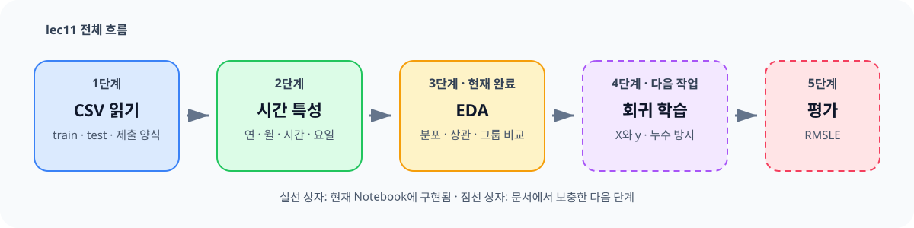

# lec11 - 자전거 대여량 회귀 실습

[이전 강의](./lec10_Pandas_Plot.md) · [전체 목차](./README.md) · [용어사전](./용어사전.md) · [원본 Notebook](../../sam/lec11_실습_회귀_bike__.ipynb)

## 오늘 이것만 기억하기

> 자전거 대여량을 예측하려면 날짜를 `연·월·시간·요일`로 나누고, 날씨와 휴일에 따라 대여량이 어떻게 달라지는지 먼저 살펴봐야 합니다.



이 수업의 목표는 시간과 날씨 정보를 보고 앞으로 필요한 자전거 수량인 `count`를 예측하는 것입니다.

```text
문제 X: 시간, 계절, 날씨, 온도, 습도, 휴일 여부
정답 y: 해당 시간의 전체 자전거 대여 수 count
```

### 현재 Notebook의 진행 범위

원본 Notebook에는 다음 내용까지 구현되어 있습니다.

1. CSV 세 개 읽기
2. `datetime`에서 연·월·일·시간·요일 만들기
3. 히스토그램과 상관계수로 데이터 살펴보기
4. 날짜·날씨·휴일에 따른 대여량 시각화
5. 평일·주말·공휴일을 나타내는 `day_type` 만들기

`LinearRegression`, 스케일러, PCA는 import되어 있지만 **모델 학습·예측·평가 셀은 아직 없습니다.** 이 문서의 “다음 단계” 예시는 회귀의 전체 흐름을 이해하기 위한 보충 설명이며, 원본 Notebook에 이미 구현된 코드가 아닙니다.

## 0. 실습 데이터 준비

이 Notebook은 Kaggle의 [Bike Sharing Demand 데이터](https://www.kaggle.com/competitions/bike-sharing-demand/data)를 사용합니다. 현재 저장소에는 아래 CSV가 없으므로 먼저 내려받아야 합니다.

```text
IT_learrning/
├─ datas/
│  └─ bike/
│     ├─ train.csv
│     ├─ test.csv
│     └─ sampleSubmission.csv
└─ sam/
   └─ lec11_실습_회귀_bike__.ipynb
```

Notebook이 `sam` 폴더를 작업 위치로 사용할 때 `../datas/bike/train.csv`가 위의 `datas/bike/train.csv`를 가리킵니다.

경로 오류가 발생하면 다음 코드로 현재 위치부터 확인합니다.

```python
from pathlib import Path

print(Path.cwd())
print(Path("../datas/bike/train.csv").resolve())
print(Path("../datas/bike/train.csv").exists())
```

마지막 결과가 `False`라면 현재 작업 위치나 CSV 저장 위치가 잘못된 것입니다.

## 1. 데이터 열 이해하기

저장된 Notebook 출력 기준으로 `train`은 10,886행 12열, `test`는 6,493행 9열입니다.

| 열 | 쉬운 뜻 | 종류 |
|---|---|---|
| `datetime` | 대여를 기록한 날짜와 시간 | 날짜·시간 |
| `season` | 계절: 1 봄, 2 여름, 3 가을, 4 겨울 | 범주 |
| `holiday` | 공휴일이면 1 | 범주 |
| `workingday` | 주말이나 공휴일이 아닌 근무일이면 1 | 범주 |
| `weather` | 1 맑음부터 4 매우 나쁜 날씨까지의 단계 | 범주 |
| `temp` | 실제 기온 | 수치 |
| `atemp` | 체감 기온 | 수치 |
| `humidity` | 상대 습도 | 수치 |
| `windspeed` | 풍속 | 수치 |
| `casual` | 비회원 대여 수 | train에만 있는 정답 관련 열 |
| `registered` | 회원 대여 수 | train에만 있는 정답 관련 열 |
| `count` | 전체 대여 수 | 예측할 정답 |

가장 중요한 관계는 다음과 같습니다.

```text
count = casual + registered
```

이 관계는 뒤에서 설명할 **타깃 누수**와 직접 연결됩니다.

## 2. CSV를 읽으면서 날짜로 변환하기

```python
import pandas as pd

train = pd.read_csv(
    "../datas/bike/train.csv",
    parse_dates=["datetime"],
)
test = pd.read_csv(
    "../datas/bike/test.csv",
    parse_dates=["datetime"],
)
sub = pd.read_csv("../datas/bike/sampleSubmission.csv")
```

`parse_dates=["datetime"]`은 글자로 저장된 날짜를 Pandas의 날짜 자료형으로 바꿉니다.

```text
"2011-01-01 00:00:00"  →  날짜 계산이 가능한 datetime
```

날짜 자료형이 되어야 `.dt.year`, `.dt.month`, `.dt.hour` 같은 기능을 사용할 수 있습니다.

```python
train.info()
test.info()
```

원본 출력에서는 결측치가 없지만, 데이터 파일이 바뀌었을 수도 있으므로 직접 실행한 `info()` 결과를 다시 확인합니다.

## 3. 날짜를 머신러닝용 숫자로 나누기

컴퓨터는 하나의 긴 날짜 문자열보다 “몇 월인가?”, “몇 시인가?”, “무슨 요일인가?”처럼 나눈 정보를 사용하기 쉽습니다.

```python
for df in [train, test]:
    df["yy"] = df["datetime"].dt.year
    df["mm"] = df["datetime"].dt.month
    df["dd"] = df["datetime"].dt.day
    df["hh"] = df["datetime"].dt.hour
    df["week"] = df["datetime"].dt.weekday
```

`weekday`는 월요일부터 일요일을 0부터 6까지로 나타냅니다.

| 숫자 | 요일 |
|---:|---|
| 0 | 월요일 |
| 1 | 화요일 |
| 2 | 수요일 |
| 3 | 목요일 |
| 4 | 금요일 |
| 5 | 토요일 |
| 6 | 일요일 |

반복문을 쓰면 train과 test에 같은 규칙을 적용했다는 사실이 코드에서 바로 보입니다.

날짜 원본은 인덱스로 보관할 수 있습니다.

```python
train = train.set_index("datetime")
test = test.set_index("datetime")
```

인덱스로 옮겨도 날짜 정보가 삭제되는 것은 아닙니다. 다시 열로 되돌리려면 `reset_index()`를 사용합니다.

## 4. 왜 `dd` 열을 삭제할까?

원본 Notebook은 train과 test의 일자 범위가 서로 갈리는 것을 확인한 뒤 `dd`를 삭제합니다.

```python
print(sorted(train["dd"].unique()))
print(sorted(test["dd"].unique()))

train = train.drop(columns=["dd"])
test = test.drop(columns=["dd"])
```

이 Kaggle 데이터는 한 달 안에서도 train과 test의 날짜 구간이 나뉘므로, `dd`가 “대여량 특징”보다 “train인지 test인지”를 알려주는 표시처럼 작동할 수 있습니다.

> 원본 Notebook 메모에는 train이 1~20일, test가 21일 이후라고 적혀 있습니다. Kaggle 공식 제출 예시는 test가 20일부터 시작하므로 메모만 믿지 말고 위 코드로 실제 CSV의 범위를 확인하세요.

`dd`를 항상 삭제해야 한다는 뜻은 아닙니다. 데이터 수집 방식과 예측 목적을 먼저 확인한 뒤 결정해야 합니다.

## 5. EDA로 데이터의 모양 살펴보기

EDA는 모델을 만들기 전에 데이터에 질문을 던지는 과정입니다.

```text
값이 한쪽에 몰렸나?
이상하게 큰 값이 있나?
대여량과 함께 움직이는 열은 무엇인가?
train과 test의 분포가 너무 다르지 않은가?
```

### 5-1. 히스토그램

```python
import matplotlib.pyplot as plt

train.hist(figsize=(16, 10))
plt.tight_layout()
plt.show()
```

히스토그램에서 확인하는 것:

- 값이 어느 구간에 많이 모이는지
- 오른쪽이나 왼쪽으로 길게 치우쳤는지
- 값이 거의 없는 구간이 있는지
- 범주형 숫자를 연속형 수치처럼 잘못 해석하고 있지 않은지

`season`, `weather`, `week`는 숫자로 저장되었지만 크기를 측정하는 연속형 수치가 아니라 그룹을 나타내는 범주입니다.

### 5-2. 상관계수 히트맵

```python
import numpy as np
import seaborn as sns

corr = train.corr(numeric_only=True)
mask = np.triu(np.ones_like(corr, dtype=bool))

plt.figure(figsize=(12, 5))
sns.heatmap(corr, annot=True, fmt=".2f", cmap="Blues", mask=mask)
plt.show()
```

상관계수는 두 수치가 함께 움직이는 정도를 -1부터 1 사이로 나타냅니다.

| 값 | 쉬운 해석 |
|---:|---|
| 1에 가까움 | 한쪽이 커질 때 다른 쪽도 커지는 경향 |
| 0에 가까움 | 직선 형태의 관계가 약함 |
| -1에 가까움 | 한쪽이 커질 때 다른 쪽은 작아지는 경향 |

상관계수가 높아도 원인과 결과라는 뜻은 아닙니다. 예를 들어 `temp`와 `atemp`가 매우 비슷한 것은 둘 다 온도를 나타내기 때문입니다.

## 6. 시간과 날씨에 따른 대여량 보기

### 6-1. 월·시간·계절별 평균

```python
fig, axes = plt.subplots(2, 3, figsize=(14, 6))
cols = ["yy", "mm", "hh", "season", "week"]

for i, col in enumerate(cols):
    row = i // 3
    col_pos = i % 3
    sns.barplot(
        data=train,
        x=col,
        y="count",
        errorbar=None,
        ax=axes[row][col_pos],
    )

plt.tight_layout()
plt.show()
```

`i // 3`은 몇 번째 줄인지, `i % 3`은 그 줄의 몇 번째 칸인지 계산합니다.

막대 높이는 해당 그룹의 평균 대여량입니다. 총대여량을 보고 싶다면 먼저 `groupby().sum()`으로 집계해야 합니다.

### 6-2. 날씨 변수와 대여량

```python
weather_cols = ["weather", "temp", "atemp", "humidity", "windspeed"]
fig, axes = plt.subplots(2, 3, figsize=(14, 6))

for i, col in enumerate(weather_cols):
    row = i // 3
    col_pos = i % 3
    sns.lineplot(
        data=train,
        x=col,
        y="count",
        errorbar=None,
        ax=axes[row][col_pos],
    )

plt.tight_layout()
plt.show()
```

`weather`는 1, 2, 3, 4라는 범주이므로 숫자 사이가 똑같은 거리라고 해석하면 안 됩니다. 선그래프는 흐름 확인용이고, 범주별 비교는 막대그래프나 박스플롯도 함께 사용하는 편이 안전합니다.

## 7. 평일·주말·공휴일 만들기

원본 Notebook은 `holiday`와 `workingday`를 합쳐 `day_type`을 만듭니다.

| `day_type` | 의미 | 조건 |
|---:|---|---|
| 0 | 평일·근무일 | `holiday == 0`이고 `workingday == 1` |
| 1 | 주말 등 비근무일 | `holiday == 0`이고 `workingday == 0` |
| 2 | 공휴일 | `holiday == 1` |

원본의 그래프 제목에는 “대체공휴일”이라고 적혀 있지만, `holiday == 1`은 일반적인 공휴일 전체를 뜻하므로 “공휴일”이 더 정확합니다.

train에만 만들면 나중에 test 예측 단계에서 열이 맞지 않습니다. 함수로 만들어 양쪽에 같은 규칙을 적용합니다.

```python
def add_day_type(df):
    result = df.copy()
    result["day_type"] = 0
    result.loc[
        (result["holiday"] == 0) & (result["workingday"] == 0),
        "day_type",
    ] = 1
    result.loc[result["holiday"] == 1, "day_type"] = 2
    return result


train = add_day_type(train)
test = add_day_type(test)
```

시간대별 회원·비회원 차이는 다음처럼 비교합니다.

```python
mean_by_hour = (
    train.groupby(["day_type", "hh"])[["count", "registered", "casual"]]
    .mean()
)

mean_by_hour.loc[0].plot(title="평일")
plt.show()
```

보통 출퇴근 시간에는 회원 대여가, 쉬는 날의 낮 시간에는 비회원 대여가 어떻게 달라지는지 질문하면서 그래프를 읽습니다.

## 8. 가장 중요한 개념: 타깃 누수

`count`를 예측하면서 `casual`과 `registered`를 문제 X에 넣으면 안 됩니다.

```text
casual + registered = count
```

정답을 구성하는 값을 문제에 넣으면 모델이 예측 원리를 학습한 것이 아니라 정답 계산식을 본 것입니다. 이를 **타깃 누수(target leakage)**라고 합니다.

또한 test에는 `casual`, `registered`, `count`가 없어서 실제 예측 시 같은 열을 사용할 수도 없습니다.

```python
target = "count"
leak_cols = ["casual", "registered", "count"]

X = train.drop(columns=leak_cols)
y = train[target]
```

## 9. 회귀는 무엇인가?

회귀는 연속적인 숫자를 예측하는 머신러닝 문제입니다.

```text
분류: 비가 온다 / 안 온다처럼 종류를 맞힌다
회귀: 대여량 237대처럼 숫자를 예측한다
```

선형회귀는 여러 특성에 계수를 곱해 더하는 방식으로 예측합니다.

```text
예측 대여량
= 시간의 영향
+ 온도의 영향
+ 습도의 영향
+ 날씨의 영향
+ 기본값
```

계수의 부호는 증가·감소 방향을 알려주지만, 범주형 숫자를 그대로 넣으면 “날씨 4는 날씨 2의 두 배” 같은 잘못된 관계를 가정할 수 있습니다. 실제 모델에서는 `season`, `weather`, `hh`, `week`, `day_type` 같은 범주를 원-핫 인코딩하는 것이 좋습니다.

## 10. 다음 단계: 첫 회귀 모델의 뼈대

아래 코드는 Notebook의 EDA 다음에 이어질 수 있는 최소 학습 흐름입니다. 시간 순서를 보존하기 위해 앞 80%를 학습, 뒤 20%를 검증에 사용합니다.

```python
from sklearn.linear_model import LinearRegression

feature_cols = [
    "season", "holiday", "workingday", "weather",
    "temp", "atemp", "humidity", "windspeed",
    "yy", "mm", "hh", "week", "day_type",
]

X = train[feature_cols].copy()
y = np.log1p(train["count"])

category_cols = ["season", "weather", "mm", "hh", "week", "day_type"]
X = pd.get_dummies(X, columns=category_cols, dtype=float)

split_index = int(len(X) * 0.8)
X_train = X.iloc[:split_index]
X_valid = X.iloc[split_index:]
y_train = y.iloc[:split_index]
y_valid = y.iloc[split_index:]

model = LinearRegression()
model.fit(X_train, y_train)

valid_log_pred = model.predict(X_valid)
valid_pred = np.expm1(valid_log_pred).clip(min=0)
valid_actual = np.expm1(y_valid)

rmsle = np.sqrt(
    np.mean(
        (np.log1p(valid_pred) - np.log1p(valid_actual)) ** 2
    )
)
print("RMSLE:", rmsle)
```

### 왜 `log1p`와 `expm1`을 사용할까?

대여량처럼 0 이상이고 큰 값 쪽으로 치우친 데이터는 로그를 취하면 큰 오차의 영향을 완화할 수 있습니다.

```text
원래 정답 y  ── np.log1p ──> 모델이 학습할 값
모델 예측값 ── np.expm1 ──> 실제 대여량 단위
```

Kaggle 공식 평가 지표는 RMSLE입니다. 음수 예측에는 로그를 적용할 수 없으므로 `clip(min=0)`으로 0보다 작지 않게 만듭니다.

### 시간 데이터는 왜 무작위로 섞지 않을까?

일반 표 데이터에서는 `train_test_split(..., random_state=42)`를 자주 사용합니다. 하지만 시간 데이터는 미래 행이 학습에 들어가고 과거 행이 검증에 들어가면 실제 운영 상황과 달라질 수 있습니다.

처음에는 앞부분으로 학습하고 뒷부분으로 검증하면서 “과거로 미래를 예측한다”는 순서를 지키는 편이 이해하기 쉽습니다.

## 11. import했지만 아직 사용하지 않은 도구

| 도구 | 역할 | 현재 Notebook |
|---|---|---|
| `LinearRegression` | 연속 숫자를 예측하는 선형 모델 | import만 됨 |
| `mean_squared_error` | 예측 오차를 제곱해 평가 | import만 됨 |
| `StandardScaler` | 평균 0, 표준편차 1로 스케일 조정 | import만 됨 |
| `MinMaxScaler` | 값을 일정 범위로 조정 | import만 됨 |
| `RobustScaler` | 중앙값과 IQR을 사용하는 스케일 조정 | import만 됨 |
| `PCA` | 여러 특성을 더 적은 축으로 압축 | import만 됨 |

스케일링과 PCA 이론은 [lec05 - 머신러닝 전처리·가공](./lec05_머신러닝_전처리_가공.md)에서 먼저 익힙니다. 첫 선형회귀를 만들 때 PCA까지 한꺼번에 적용할 필요는 없습니다.

## 12. 자주 만나는 오류

### `FileNotFoundError`

`datas/bike`에 CSV 세 개가 있는지, Notebook의 현재 작업 위치가 `sam`인지 확인합니다.

### `KeyError: 'count'`

`test.csv`에는 정답인 `count`가 없습니다. `count`를 사용하는 EDA와 모델 학습은 train으로만 합니다.

### train과 test의 열 개수가 다름

train에는 정답 관련 열 `casual`, `registered`, `count`가 더 있습니다. 모델 입력 열은 이름 목록으로 명시하고, 파생 특성은 양쪽에 똑같이 만듭니다.

### 그래프의 한글이 네모로 보임

Windows에서는 다음 설정을 먼저 실행합니다.

```python
plt.rcParams["font.family"] = "Malgun Gothic"
plt.rcParams["axes.unicode_minus"] = False
```

## 직접 확인 문제

1. `parse_dates=["datetime"]`을 사용하는 이유는 무엇인가요?
2. `datetime`에서 만든 `hh`와 `week`는 각각 무엇을 뜻하나요?
3. `casual`과 `registered`를 모델 입력에서 빼야 하는 이유는 무엇인가요?
4. `day_type`을 test에도 만들어야 하는 이유는 무엇인가요?
5. 시간 데이터 검증에서 행을 무작위로 섞는 것을 조심해야 하는 이유는 무엇인가요?

## 핵심 체크리스트

- 회귀가 연속적인 숫자를 예측하는 문제라는 것을 아나요?
- `count`가 예측할 정답이라는 것을 아나요?
- 날짜를 연·월·시간·요일로 분리할 수 있나요?
- EDA가 모델 학습 전 데이터의 패턴과 문제를 찾는 과정임을 아나요?
- `casual`, `registered`가 타깃 누수를 일으킨다는 것을 설명할 수 있나요?
- 현재 Notebook은 EDA까지이며 모델 학습은 아직 없다는 것을 구분할 수 있나요?
