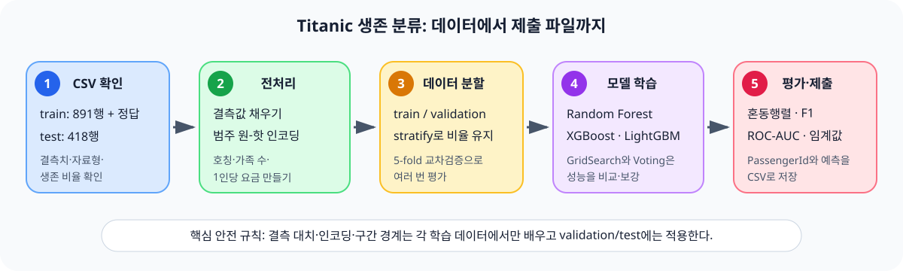
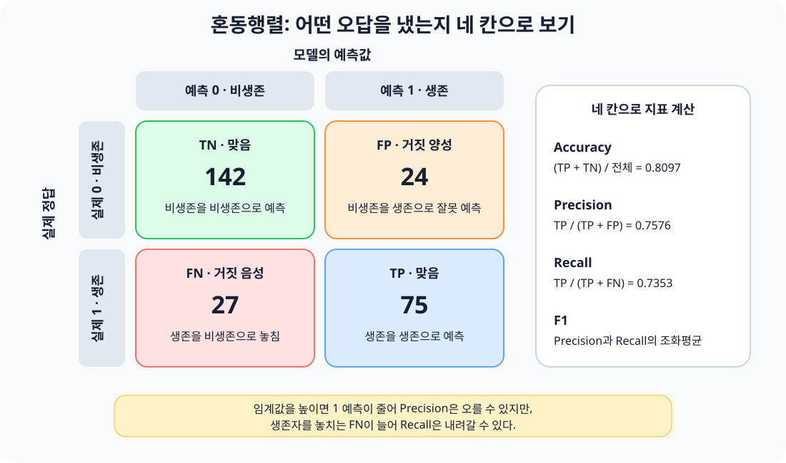

# lec12 - Titanic 생존 분류 실습

[이전 강의](./lec11_자전거_대여량_회귀.md) · [전체 목차](./README.md) · [용어사전](./용어사전.md) · [원본 Notebook](../../sam/lec12_실습_분류_titanic__.ipynb)

## 오늘 이것만 기억하기

> 분류 모델은 종류를 맞힙니다. 정확도 하나만 보지 말고 **혼동행렬 → 정밀도·재현율·F1 → ROC-AUC → 임계값** 순서로 오답의 종류까지 확인해야 합니다.



이 수업의 목표는 승객 정보를 보고 `survived`가 0인지 1인지 예측하는 것입니다.

```text
문제 X: 객실 등급, 성별, 나이, 가족 수, 요금, 승선항, 이름에서 얻은 호칭
정답 y: survived
         0 = 생존하지 못함
         1 = 생존
```

### 원본 Notebook의 진행 범위

원본 Notebook에는 다음 내용이 구현되어 있습니다.

1. train, test, 제출 양식 CSV 읽기
2. 결측치와 문자형 열 확인
3. `map`, `replace`, `lambda`, `LabelEncoder`, `OneHotEncoder`, `get_dummies` 비교
4. 이름에서 호칭을 추출하고 나이 결측치 보간
5. 가족 수, 1인 탑승 여부, 1인당 요금, 요금 구간 파생 특성 생성
6. Random Forest, XGBoost, LightGBM 분류 모델 비교
7. 혼동행렬, 정확도, 정밀도, 재현율, F1, ROC-AUC 평가
8. KFold, StratifiedKFold, `cross_val_score`, `cross_validate`, GridSearchCV
9. Voting 앙상블과 분류 임계값 조정

Notebook에는 Kaggle 제출 파일을 만드는 마지막 단계가 없습니다. 이 문서의 안전한 Pipeline과 제출 예시는 전체 흐름을 연결하기 위한 보강 자료입니다.

## 0. 실습 파일 준비

저장소에는 필요한 Titanic CSV가 함께 들어 있습니다.

```text
IT_learrning/
├─ datas/
│  └─ titanic/
│     ├─ train.csv
│     ├─ test.csv
│     └─ gender_submission.csv
└─ sam/
   └─ lec12_실습_분류_titanic__.ipynb
```

Notebook을 `sam` 폴더에서 실행하면 `../datas/titanic/train.csv`가 프로젝트의 `datas/titanic/train.csv`를 가리킵니다.

```python
from pathlib import Path

data_path = Path("../datas/titanic")
print(data_path.resolve())
print((data_path / "train.csv").exists())
```

마지막 결과가 `False`이면 JupyterLab의 현재 작업 폴더를 확인합니다.

## 1. 세 파일의 역할

실제 CSV를 확인한 결과는 다음과 같습니다.

| 파일 | 크기 | 역할 |
|---|---:|---|
| `train.csv` | 891행 × 12열 | 승객 정보와 정답 `Survived`가 있는 학습 데이터 |
| `test.csv` | 418행 × 11열 | 정답 없이 예측해야 하는 승객 데이터 |
| `gender_submission.csv` | 418행 × 2열 | `PassengerId`, `Survived` 형식의 제출 예시 |

train과 test의 차이는 정답 열입니다.

```text
train = X + y
test  = X만 있음
```

`PassengerId`는 예측 규칙을 배우는 특성으로는 보통 제외하지만, 제출 파일을 만들 때 반드시 필요합니다. 삭제하기 전에 별도 변수에 보관합니다.

```python
test_ids = test["PassengerId"].copy()
```

실제 test와 제출 예시의 `PassengerId` 418개는 같은 순서로 정렬되어 있습니다. 그래도 행 순서를 바꾸는 코드를 추가했다면 ID를 기준으로 다시 맞춰야 합니다.

## 2. 데이터 열 이해하기

| 원본 열 | 소문자 이름 | 쉬운 뜻 | 종류 |
|---|---|---|---|
| `PassengerId` | `passengerid` | 승객을 구별하는 번호 | 식별자 |
| `Survived` | `survived` | 생존 여부 0/1 | 정답 |
| `Pclass` | `pclass` | 티켓 등급 1·2·3등석 | 범주 |
| `Name` | `name` | 승객 이름과 호칭 | 문자열 |
| `Sex` | `sex` | 성별 | 범주 |
| `Age` | `age` | 나이 | 수치 |
| `SibSp` | `sibsp` | 함께 탄 형제·자매·배우자 수 | 수치 |
| `Parch` | `parch` | 함께 탄 부모·자녀 수 | 수치 |
| `Ticket` | `ticket` | 티켓 번호 | 문자열 |
| `Fare` | `fare` | 승선 요금 | 수치 |
| `Cabin` | `cabin` | 객실 번호 | 문자열·결측 다수 |
| `Embarked` | `embarked` | 승선항 C·Q·S | 범주 |

열 이름을 소문자로 통일하면 대소문자 실수를 줄일 수 있습니다.

```python
train.columns = train.columns.str.lower()
test.columns = test.columns.str.lower()
```

## 3. 분류와 회귀의 차이

lec11은 자전거 대여량이라는 연속 숫자를 예측하는 **회귀**였습니다. lec12는 두 종류 중 하나를 예측하는 **이진 분류**입니다.

| 구분 | 맞히는 값 | 예 | 대표 평가 |
|---|---|---|---|
| 회귀 | 연속적인 숫자 | 대여량 237대 | RMSE, RMSLE |
| 분류 | 정해진 클래스 | 생존 0 또는 1 | 정확도, F1, ROC-AUC |

모델은 먼저 각 클래스의 가능성을 계산한 뒤 기준값인 임계값을 사용해 0 또는 1로 결정할 수 있습니다.

```text
생존 확률 0.82 ── 임계값 0.50 이상 ──> 생존 1
생존 확률 0.34 ── 임계값 0.50 미만 ──> 비생존 0
```

## 4. 첫 EDA: 크기, 자료형, 결측치

```python
print(train.shape, test.shape)
train.info()
test.info()
```

실제 원본 데이터의 결측치는 다음과 같습니다.

| 열 | train 결측 | test 결측 | Notebook 처리 |
|---|---:|---:|---|
| `age` | 177 | 86 | 호칭별 평균 나이로 채움 |
| `cabin` | 687 | 327 | 열 삭제 |
| `embarked` | 2 | 0 | train 최빈값으로 채움 |
| `fare` | 0 | 1 | 같은 3등석·1인 승객의 train 평균으로 채움 |

결측치가 많다는 이유만으로 무조건 열을 버리지는 않습니다. `cabin`의 첫 글자를 갑판 정보로 만들 수도 있습니다. 이번 Notebook은 처음 배우는 단계이므로 삭제하는 단순한 선택을 사용합니다.

### 정답 비율도 먼저 확인하기

```python
train["survived"].value_counts()
train["survived"].value_counts(normalize=True)
```

실제 train에는 비생존 549명, 생존 342명이 있으며 생존 비율은 약 38.38%입니다.

모든 사람을 비생존으로만 예측해도 정확도는 약 61.62%입니다. 따라서 80% 정확도라는 숫자만 보고 충분히 좋은 모델이라고 판단하면 안 됩니다.

```python
majority_baseline = train["survived"].value_counts(normalize=True).max()
print(majority_baseline)  # 약 0.6162
```

## 5. 데이터에서 실제로 보이는 패턴

원본 CSV를 단순 그룹 평균으로 확인한 결과입니다.

| 그룹 | 생존 비율 |
|---|---:|
| 여성 | 74.20% |
| 남성 | 18.89% |
| 1등석 | 62.96% |
| 2등석 | 47.28% |
| 3등석 | 24.24% |
| Cherbourg 승선 | 55.36% |
| Queenstown 승선 | 38.96% |
| Southampton 승선 | 33.70% |

이 수치는 데이터 안의 **연관성**입니다. 성별이나 객실 등급 하나가 생존의 유일한 원인이라는 뜻은 아닙니다. 여러 조건이 함께 얽혀 있으므로 모델과 교차검증으로 새 데이터에서도 비슷한 규칙이 유지되는지 확인합니다.

## 6. 범주형 데이터를 숫자로 바꾸기

컴퓨터 모델은 `male`, `female`, `S`, `C`, `Q` 같은 글자를 그대로 계산하기 어렵습니다. 이를 숫자로 바꾸는 과정을 인코딩이라고 합니다.

### Notebook에서 비교하는 여섯 방법

| 방법 | 핵심 | 적합한 경우 | 주의점 |
|---|---|---|---|
| `map` | 딕셔너리로 값 대응 | 규칙이 짧고 분명할 때 | 사전에 없는 값은 `NaN` |
| `replace` | 여러 값을 다른 값으로 교체 | 단순 값 치환 | 순서형 의미를 자동으로 만들지는 않음 |
| `apply(lambda)` | 행마다 함수 적용 | 조건이 복잡할 때 | 단순 치환에는 느리고 길어질 수 있음 |
| `LabelEncoder` | 클래스를 0부터 번호화 | 원래는 정답 `y` 인코딩용 | 입력 범주에 가짜 순서를 만들 수 있음 |
| `OneHotEncoder` | 범주마다 0/1 열 생성 | Pipeline과 새 범주 대응 | 입력은 `[[...]]` 형태의 2차원이어야 함 |
| `pd.get_dummies` | DataFrame에서 0/1 열 생성 | 빠른 EDA와 간단한 실습 | train/test 열을 맞춰야 함 |

`sex`처럼 두 범주만 있고 의미가 명확하면 0/1 매핑도 이해하기 쉽습니다.

```python
train["sex"] = train["sex"].map({"male": 0, "female": 1})
```

반면 `embarked`를 `S=0, C=1, Q=2`로 바꾸면 숫자 크기에 실제로 존재하지 않는 순서와 거리가 생깁니다. Logistic Regression이나 KNN에서는 원-핫 인코딩이 더 안전합니다.

```python
pd.get_dummies(train, columns=["sex", "embarked"], dtype=int)
```

### train과 test 열 맞추기

`get_dummies`를 각각 실행하면 한쪽에만 있는 범주 때문에 열이 달라질 수 있습니다.

```python
train_encoded = pd.get_dummies(train, columns=["sex", "embarked"], dtype=int)
test_encoded = pd.get_dummies(test, columns=["sex", "embarked"], dtype=int)

X_train, X_test = train_encoded.align(
    test_encoded,
    join="left",
    axis=1,
    fill_value=0,
)
```

실전에서는 뒤에서 소개하는 `OneHotEncoder(handle_unknown="ignore")`와 Pipeline을 권장합니다.

## 7. 이름에서 호칭 추출하기

이름 전체는 거의 모든 행에서 달라 그대로 쓰기 어렵지만 `Mr`, `Mrs`, `Miss`, `Master` 같은 호칭은 나이·성별·사회적 정보의 일부를 요약합니다.

```python
train["title"] = train["name"].str.extract(r", (.*?)\.", expand=False)
```

정규표현식을 조각으로 읽으면 다음과 같습니다.

```text
,          쉼표 뒤에서 시작
(.*?)      가능한 짧게 글자를 가져옴
\.         마침표 앞에서 끝냄
```

Notebook은 드문 호칭을 `Mr`, `Mrs`, `Miss`, `Master` 네 그룹으로 합칩니다. 사전에 없는 호칭은 `map` 결과가 결측치가 될 수 있으므로 확인이 필요합니다.

```python
print(train.loc[train["title"].isna(), "name"])
```

드문 호칭을 무조건 특정 성별 호칭으로 합치기보다 `Rare`라는 별도 그룹으로 두면 의미를 덜 왜곡합니다.

## 8. 결측치 처리에서 가장 중요한 규칙

Notebook은 호칭별 평균 나이로 `age`를 채웁니다.

```python
train["age"] = train["age"].fillna(
    train.groupby("name")["age"].transform("mean").round(1)
)
```

`groupby(...).transform("mean")`은 그룹 평균을 원래 행 수와 같은 길이로 되돌려 줍니다. 그래서 `fillna`에 바로 사용할 수 있습니다.

하지만 모델 성능을 공정하게 평가하려면 순서를 지켜야 합니다.

```text
잘못된 순서
전체 데이터 평균 계산 → 결측치 채움 → train/validation 분할

안전한 순서
train/validation 분할 → train에서 평균 학습 → 양쪽에 같은 규칙 적용
```

전체 데이터로 평균이나 구간 경계를 먼저 계산하면 validation 정보를 미리 본 셈이 됩니다. 이를 데이터 누수라고 합니다. `SimpleImputer`, `OneHotEncoder`, 모델을 Pipeline으로 묶으면 교차검증의 각 fold 안에서도 이 순서를 지킬 수 있습니다.

또한 test의 평균을 test 자체에서 따로 계산하기보다 train에서 배운 값을 test에 적용해야 실제 서비스 상황과 같습니다.

## 9. 파생 특성 만들기

### 가족 수

```python
train["family_cnt"] = train["sibsp"] + train["parch"] + 1
```

마지막 `+ 1`은 승객 본인입니다.

### 혼자 탑승했는지

```python
train["is_alone"] = (train["family_cnt"] == 1).astype(int)
```

조건 결과 `True/False`를 `1/0`으로 바꿉니다.

### 1인당 요금

```python
train["fare_rate"] = train["fare"] / train["family_cnt"]
```

같은 티켓을 가족이 함께 사용했을 가능성을 간단히 반영합니다.

### 나이대와 요금 구간

```python
train["age_group"] = train["age"] // 10
train["fare_bin"] = pd.qcut(train["fare"], q=4, labels=False)
```

`qcut`은 각 구간에 비슷한 수의 행이 들어가도록 경계를 데이터에서 학습합니다. train과 test에 각각 `qcut`을 실행하면 서로 다른 경계가 생깁니다.

```python
train["fare_bin"], fare_edges = pd.qcut(
    train["fare"],
    q=4,
    labels=False,
    retbins=True,
    duplicates="drop",
)
test["fare_bin"] = pd.cut(
    test["fare"],
    bins=fare_edges,
    labels=False,
    include_lowest=True,
)
```

Notebook의 2차 파생 특성 셀은 `IsAlone`, `FareBin`을 train에만 만듭니다. Kaggle test 예측까지 진행하려면 test에도 같은 이름과 규칙으로 생성해야 합니다.

## 10. 학습용과 검증용으로 나누기

```python
from sklearn.model_selection import train_test_split

X = train.drop(columns=["survived"])
y = train["survived"]

X_train, X_valid, y_train, y_valid = train_test_split(
    X,
    y,
    test_size=0.3,
    random_state=1234,
    shuffle=True,
    stratify=y,
)
```

`stratify=y`는 전체 데이터의 0과 1 비율이 train과 validation에도 비슷하게 유지되도록 돕습니다. Notebook의 `myscore222`에는 이 옵션이 없으므로 같은 분류 실습을 다시 작성할 때 추가하는 편이 좋습니다.

```text
train 70%       모델이 규칙을 배움
validation 30%  학습에 쓰지 않은 정답으로 중간 평가
Kaggle test     정답이 공개되지 않은 최종 예측 대상
```

## 11. 첫 모델과 Notebook 저장 점수

Notebook은 `random_state=1234`, validation 30% 한 번 분할을 사용합니다. 저장된 결과는 다음과 같습니다.

| 모델 | Accuracy | F1 | Precision | Recall | ROC-AUC |
|---|---:|---:|---:|---:|---:|
| Random Forest | 0.8097 | 0.7463 | 0.7576 | 0.7353 | 0.8620 |
| XGBoost | 0.8321 | 0.7739 | 0.7938 | 0.7549 | 0.8491 |
| LightGBM | 0.8134 | 0.7449 | 0.7766 | 0.7157 | 0.8457 |
| Random Forest + 2차 파생 특성 | 0.8284 | 0.7723 | 0.7800 | 0.7647 | 0.8619 |
| Random Forest + 원-핫 인코딩 | 0.8209 | 0.7600 | 0.7755 | 0.7451 | 0.8590 |
| Hard Voting | 0.8433 | 0.7857 | - | - | - |

이 표는 Notebook에 저장된 **한 번의 validation 결과**입니다. Kaggle 점수도 아니고, 모델의 우열이 확정된 것도 아닙니다. 분할이 달라지면 순위가 바뀔 수 있으므로 교차검증 평균과 fold별 흔들림을 함께 봅니다.

## 12. 혼동행렬을 먼저 읽기



scikit-learn의 이진 혼동행렬은 행이 실제값, 열이 예측값입니다.

```text
[[TN, FP],
 [FN, TP]]
```

Random Forest 첫 결과는 다음과 같습니다.

```text
[[142, 24],
 [ 27, 75]]
```

| 값 | 이 실습에서의 뜻 | 개수 |
|---|---|---:|
| TN | 실제 비생존을 비생존으로 맞힘 | 142 |
| FP | 실제 비생존을 생존으로 잘못 예측 | 24 |
| FN | 실제 생존을 비생존으로 놓침 | 27 |
| TP | 실제 생존을 생존으로 맞힘 | 75 |

`confusion_matrix`의 0과 1 순서를 모르면 FP와 FN을 반대로 읽기 쉽습니다.

```python
from sklearn.metrics import confusion_matrix

cm = confusion_matrix(y_valid, pred, labels=[0, 1])
tn, fp, fn, tp = cm.ravel()
```

## 13. Accuracy, Precision, Recall, F1

### 정확도 Accuracy

전체 예측 중 맞힌 비율입니다.

```text
Accuracy = (TP + TN) / (TP + TN + FP + FN)
```

클래스가 불균형하면 다수 클래스만 예측해도 높아질 수 있습니다.

### 정밀도 Precision

모델이 생존이라고 예측한 사람 중 실제 생존자의 비율입니다.

```text
Precision = TP / (TP + FP)
```

FP를 줄이는 것이 중요할 때 봅니다.

### 재현율 Recall

실제 생존자 중 모델이 생존으로 찾아낸 비율입니다.

```text
Recall = TP / (TP + FN)
```

FN을 줄여 실제 양성을 놓치지 않는 것이 중요할 때 봅니다.

### F1 score

정밀도와 재현율의 조화평균입니다.

```text
F1 = 2 × Precision × Recall / (Precision + Recall)
```

한쪽만 매우 높고 다른 쪽이 낮으면 F1도 낮아집니다. 어떤 지표를 선택할지는 틀린 예측의 비용에 따라 결정합니다.

## 14. 확률과 임계값

```python
proba = model.predict_proba(X_valid)
survival_proba = proba[:, 1]
pred_08 = (survival_proba >= 0.8).astype(int)
```

`proba[:, 1]`은 각 행이 클래스 1일 확률입니다.

```text
임계값을 낮춤 → 1로 예측하는 사람 증가 → Recall 상승 가능, FP 증가 가능
임계값을 높임 → 1로 예측하는 사람 감소 → Precision 상승 가능, FN 증가 가능
```

Notebook 실행 결과에서 기본 예측은 precision 0.7800, recall 0.7647이었습니다. 코드의 임계값을 0.8로 높인 결과 precision은 0.8871로 올라가고 recall은 0.5392로 내려갔습니다.

Notebook 마지막 설명에는 0.9라고 적혀 있지만 실행 코드와 저장 출력은 0.8입니다. 재실습할 때 코드의 `threshold` 값을 기준으로 결과를 기록합니다.

임계값은 최종 test 정답을 보면서 고르면 안 됩니다. validation 또는 교차검증 예측에서 목적에 맞게 선택한 뒤 마지막 test에는 한 번만 적용합니다.

## 15. Precision-Recall 곡선과 ROC-AUC

`precision_recall_curve`는 임계값을 바꾸면서 정밀도와 재현율이 어떻게 교환되는지 보여줍니다.

```python
from sklearn.metrics import precision_recall_curve

precision, recall, thresholds = precision_recall_curve(
    y_valid,
    survival_proba,
)
```

ROC 곡선은 여러 임계값에서 TPR과 FPR을 비교합니다.

```text
TPR = Recall = TP / (TP + FN)
FPR = FP / (FP + TN)
```

ROC-AUC는 ROC 곡선 아래 면적입니다. 1에 가까울수록 양성과 음성을 순서대로 잘 구분하는 경향이 있고, 약 0.5면 무작위 순위와 비슷합니다. AUC가 높아도 실제 사용할 임계값에서 precision과 recall이 목적에 맞는지 따로 확인해야 합니다.

## 16. 교차검증은 데이터 증폭이 아니다

5-fold 교차검증은 학습 데이터를 5조각으로 나누고, 한 조각씩 validation 역할을 바꾸어 5번 평가합니다.

```text
1회: [검증] [학습] [학습] [학습] [학습]
2회: [학습] [검증] [학습] [학습] [학습]
3회: [학습] [학습] [검증] [학습] [학습]
4회: [학습] [학습] [학습] [검증] [학습]
5회: [학습] [학습] [학습] [학습] [검증]
```

같은 행을 역할만 바꾸어 재사용합니다. 새 승객 행을 만들어 내는 데이터 증강이나 증폭이 아닙니다.

### KFold와 StratifiedKFold

| 방법 | 분할 기준 | Titanic 분류에서의 선택 |
|---|---|---|
| `KFold` | 행 수를 비슷하게 나눔 | fold마다 생존 비율이 달라질 수 있음 |
| `StratifiedKFold` | 정답 클래스 비율도 비슷하게 유지 | 이진 분류 기본 선택으로 이해하기 쉬움 |

```python
from sklearn.model_selection import StratifiedKFold, cross_validate

cv = StratifiedKFold(n_splits=5, shuffle=True, random_state=1234)
scores = cross_validate(
    model,
    X,
    y,
    cv=cv,
    scoring=["accuracy", "f1", "roc_auc"],
)

print(scores["test_f1"].mean())
print(scores["test_f1"].std())
```

평균은 예상 성능의 중심을, 표준편차는 분할에 따른 흔들림을 보여줍니다.

Notebook의 Random Forest 5-fold 결과는 다음과 같습니다.

| 방법 | 평균 Accuracy | 평균 F1 |
|---|---:|---:|
| 직접 KFold 반복 | 0.8092 | 0.7455 |
| 직접 StratifiedKFold 반복 | 0.8013 | 0.7357 |
| `cross_validate` | 0.8070 | 0.7414 |

서로 모델 설정과 분할 방식이 일부 다르므로 숫자를 단순히 한 줄 순위로 해석하지 않습니다.

## 17. GridSearchCV와 하이퍼파라미터

하이퍼파라미터는 모델이 학습하기 전에 사람이 정하는 설정입니다.

| Random Forest 설정 | 뜻 |
|---|---|
| `n_estimators` | 만들 나무 개수 |
| `min_samples_split` | 노드를 나누기 위한 최소 표본 수 |
| `min_samples_leaf` | 잎 노드에 남아야 할 최소 표본 수 |
| `max_depth` | 나무의 최대 깊이 |

`GridSearchCV`는 지정한 조합을 모두 교차검증해 선택합니다.

```python
from sklearn.model_selection import GridSearchCV

params = {
    "n_estimators": [100, 200, 300],
    "min_samples_split": [2, 3, 4],
    "min_samples_leaf": [1, 2, 3],
}

search = GridSearchCV(
    RandomForestClassifier(random_state=1234),
    param_grid=params,
    scoring="f1",
    cv=cv,
    refit=True,
)
search.fit(X, y)
```

Notebook의 최적 조합은 다음과 같이 저장되어 있습니다.

```text
min_samples_leaf = 3
min_samples_split = 2
n_estimators = 100
교차검증 최고 F1 ≈ 0.7802
```

`refit=True`이면 선택된 설정으로 전체 입력 데이터를 다시 학습한 `best_estimator_`가 만들어집니다. GridSearchCV도 데이터를 늘리는 기능이 아니라 여러 설정을 반복 평가하는 기능입니다.

같은 교차검증 점수로 설정을 고르고 그 점수를 최종 성능처럼 발표하면 낙관적일 수 있습니다. 가능하면 마지막 hold-out test를 따로 남기거나 nested cross-validation을 사용합니다.

## 18. 앙상블: 여러 모델의 판단 합치기

### Random Forest와 배깅

Random Forest는 여러 결정 트리를 서로 조금 다른 표본과 특성으로 학습한 뒤 결과를 합칩니다. 한 나무의 흔들림을 여러 나무의 평균·투표로 줄이는 방식입니다.

### XGBoost와 LightGBM의 부스팅

부스팅은 앞 모델이 틀린 부분을 다음 모델이 보완하도록 순차적으로 작은 모델을 쌓습니다. Notebook의 “같은 데이터, 다른 모델”은 지나친 단순화입니다. 일반적인 boosting은 서로 다른 종류의 모델을 섞기보다 같은 계열의 약한 학습기를 순차적으로 추가합니다.

### VotingClassifier

Notebook은 Logistic Regression, Decision Tree, KNN을 합칩니다.

```python
VotingClassifier(
    estimators=[
        ("lr", logistic_model),
        ("dt", tree_model),
        ("knn", knn_model),
    ],
    voting="hard",
)
```

| 방식 | 합치는 값 | 뜻 |
|---|---|---|
| hard voting | 각 모델이 고른 0 또는 1 | 다수결 |
| soft voting | 각 모델의 클래스 확률 | 평균 확률이 가장 큰 클래스 선택 |

KNN과 Logistic Regression은 특성의 숫자 범위에 영향을 받습니다. `fare`가 0/1 범주보다 훨씬 큰 상태로 그대로 넣으면 KNN 거리 계산이 요금에 끌릴 수 있으므로 `StandardScaler`를 각 모델 Pipeline 안에 넣는 편이 공정합니다. soft voting은 확률의 품질도 중요합니다.

## 19. 권장 보강: 누수를 막는 전체 Pipeline

다음 예시는 원본 CSV부터 시작합니다. 먼저 분할하고, 각 fold의 학습 부분에서만 결측 대치와 인코딩을 학습합니다.

```python
import numpy as np
import pandas as pd

from sklearn.compose import ColumnTransformer
from sklearn.ensemble import RandomForestClassifier
from sklearn.impute import SimpleImputer
from sklearn.metrics import classification_report, roc_auc_score
from sklearn.model_selection import train_test_split
from sklearn.pipeline import Pipeline
from sklearn.preprocessing import OneHotEncoder


def add_titanic_features(df):
    result = df.copy()
    result.columns = result.columns.str.lower()

    result["title"] = result["name"].str.extract(
        r", (.*?)\.",
        expand=False,
    )
    result["title"] = result["title"].replace({
        "Mlle": "Miss",
        "Ms": "Miss",
        "Mme": "Mrs",
    })
    common_titles = ["Mr", "Miss", "Mrs", "Master"]
    result["title"] = result["title"].where(
        result["title"].isin(common_titles),
        "Rare",
    )

    result["family_cnt"] = result["sibsp"] + result["parch"] + 1
    result["is_alone"] = (result["family_cnt"] == 1).astype(int)
    result["fare_rate"] = result["fare"] / result["family_cnt"]

    return result.drop(
        columns=["passengerid", "name", "ticket", "cabin"],
    )


raw_train = pd.read_csv("../datas/titanic/train.csv")
raw_test = pd.read_csv("../datas/titanic/test.csv")
test_ids = raw_test["PassengerId"].copy()

y = raw_train["Survived"]
X = add_titanic_features(raw_train.drop(columns=["Survived"]))
X_submit = add_titanic_features(raw_test)

numeric_cols = [
    "age", "sibsp", "parch", "fare",
    "family_cnt", "is_alone", "fare_rate",
]
category_cols = ["pclass", "sex", "embarked", "title"]

numeric_pipe = Pipeline([
    ("imputer", SimpleImputer(strategy="median")),
])

category_pipe = Pipeline([
    ("imputer", SimpleImputer(strategy="most_frequent")),
    ("onehot", OneHotEncoder(handle_unknown="ignore")),
])

preprocess = ColumnTransformer([
    ("num", numeric_pipe, numeric_cols),
    ("cat", category_pipe, category_cols),
])

model = Pipeline([
    ("preprocess", preprocess),
    ("model", RandomForestClassifier(
        n_estimators=300,
        random_state=1234,
    )),
])

X_train, X_valid, y_train, y_valid = train_test_split(
    X,
    y,
    test_size=0.3,
    random_state=1234,
    stratify=y,
)

model.fit(X_train, y_train)
pred = model.predict(X_valid)
proba = model.predict_proba(X_valid)[:, 1]

print(classification_report(y_valid, pred))
print("ROC-AUC:", roc_auc_score(y_valid, proba))
```

### Pipeline 전체를 교차검증하기

```python
from sklearn.model_selection import StratifiedKFold, cross_validate

cv = StratifiedKFold(n_splits=5, shuffle=True, random_state=1234)
scores = cross_validate(
    model,
    X,
    y,
    cv=cv,
    scoring=["accuracy", "f1", "roc_auc"],
    n_jobs=-1,
)

for metric in ["test_accuracy", "test_f1", "test_roc_auc"]:
    print(metric, scores[metric].mean(), scores[metric].std())
```

GridSearchCV에서 Pipeline 속 모델 설정은 `model__` 접두사를 붙입니다.

```python
search = GridSearchCV(
    model,
    param_grid={
        "model__n_estimators": [100, 300],
        "model__min_samples_leaf": [1, 2, 3],
    },
    scoring="f1",
    cv=cv,
    n_jobs=-1,
    refit=True,
)
search.fit(X, y)
```

## 20. Kaggle 제출 파일 만들기

교차검증과 모델 선택을 끝낸 뒤 전체 train으로 한 번 더 학습합니다.

```python
final_model = search.best_estimator_
final_model.fit(X, y)

test_pred = final_model.predict(X_submit).astype(int)

submission = pd.DataFrame({
    "PassengerId": test_ids,
    "Survived": test_pred,
})

submission.to_csv("titanic_submission.csv", index=False)
submission.head()
```

제출 전 네 가지를 확인합니다.

```python
print(submission.shape)                 # (418, 2)
print(submission.columns.tolist())      # ['PassengerId', 'Survived']
print(submission["PassengerId"].is_unique)
print(submission["Survived"].value_counts())
```

`index=False`를 빼면 불필요한 인덱스 열이 추가될 수 있습니다.

## 21. Notebook을 다시 볼 때 꼭 구분할 내용

| Notebook 표현·코드 | 정확하게 이해할 내용 |
|---|---|
| 교차검증은 “데이터 증폭” | 행을 새로 만들지 않고 학습·검증 역할을 바꾸어 반복 평가 |
| GridSearchCV는 “증폭 + 튜닝” | 여러 하이퍼파라미터 조합을 교차검증으로 탐색 |
| `LabelEncoder`로 입력 특성 변환 | `LabelEncoder`는 정답용이며 입력 범주는 OneHotEncoder가 안전 |
| 전처리 후 `train_test_split` | 평균·구간·인코더를 전체에서 학습하면 validation 누수 가능 |
| Spearman 제목 아래 `train.corr()` | 실제 히트맵도 `train.corr(method="spearman")`을 사용해야 함 |
| `IsAlone`, `FareBin`을 train에만 생성 | test에도 같은 규칙과 같은 열을 만들어야 예측 가능 |
| `qcut`을 train/test에 따로 사용 | train 경계를 저장하고 test에는 `cut`으로 적용 |
| 마지막 설명 임계값 0.9 | 실제 실행 코드는 0.8이며 저장 점수도 0.8 결과 |
| `warnings.filterwarnings("ignore")` | 중요한 경고까지 숨길 수 있어 문제 해결 중에는 제거 |
| `PassengerId` 삭제 | 모델에서는 빼더라도 제출용 ID는 별도 보관 |

### Spearman 히트맵 수정 예

```python
corr_spearman = train.corr(method="spearman")
mask = np.triu(np.ones_like(corr_spearman, dtype=bool))

sns.heatmap(
    corr_spearman,
    annot=True,
    fmt=".2f",
    cmap="Blues",
    mask=mask,
)
plt.show()
```

## 22. 자주 만나는 오류

### `FileNotFoundError`

Notebook을 `sam`에서 실행하는지, `datas/titanic`에 CSV 세 개가 있는지 확인합니다.

### `ValueError: could not convert string to float`

`sex`, `embarked`, `name`, `ticket`, `cabin` 같은 글자 열이 남아 있습니다. 사용할 열을 인코딩하고 나머지는 제외합니다.

### `Input X contains NaN`

`age`, `embarked`, test의 `fare` 또는 호칭 매핑 결과에 결측치가 남았습니다.

```python
X.isna().sum().loc[lambda s: s > 0]
```

### train과 test의 열 개수가 다름

파생 특성이나 dummy 열을 한쪽에만 만들었습니다. Pipeline의 `OneHotEncoder(handle_unknown="ignore")`를 사용하거나 열을 `align`합니다.

### `No module named 'xgboost'` 또는 `'lightgbm'`

가상환경을 활성화하고 전체 requirements를 다시 설치합니다.

```powershell
python -m pip install -r .\docs\lec\requirements.txt
```

### 점수가 실행할 때마다 달라짐

데이터 분할기와 모델에 `random_state`를 지정합니다. XGBoost와 LightGBM은 버전·병렬 연산 환경에 따라 아주 작은 차이가 생길 수 있습니다.

## 23. 직접 확인 문제

1. Titanic 문제는 회귀와 분류 중 무엇인가요?
2. `PassengerId`를 모델 입력에서는 빼더라도 따로 보관해야 하는 이유는 무엇인가요?
3. `embarked`를 0·1·2 한 열로 바꾸면 어떤 잘못된 의미가 생길 수 있나요?
4. 호칭별 평균 나이 계산을 validation 분할 전에 하면 왜 누수가 될 수 있나요?
5. 혼동행렬 `[[142, 24], [27, 75]]`에서 FN은 몇 명인가요?
6. 임계값을 높이면 precision과 recall은 보통 어떤 방향으로 움직이나요?
7. 교차검증이 데이터 증강과 다른 이유는 무엇인가요?
8. StratifiedKFold가 분류에서 유용한 이유는 무엇인가요?
9. GridSearchCV의 `refit=True`는 무엇을 해 주나요?
10. hard voting과 soft voting은 무엇을 합치나요?

## 핵심 체크리스트

- `survived`가 0/1 이진 분류의 정답이라는 것을 설명할 수 있나요?
- train, validation, Kaggle test의 역할을 구분할 수 있나요?
- 결측 대치와 인코딩을 train에서만 학습해야 한다는 것을 아나요?
- TN, FP, FN, TP를 실제값·예측값 조합으로 읽을 수 있나요?
- accuracy만으로 불균형 분류 모델을 평가하면 안 되는 이유를 말할 수 있나요?
- precision, recall, F1의 차이를 설명할 수 있나요?
- 임계값을 바꾸면 FP와 FN도 바뀐다는 것을 아나요?
- 교차검증과 GridSearchCV가 데이터를 새로 생성하지 않는다는 것을 아나요?
- 배깅, 부스팅, Voting의 차이를 한 문장씩 말할 수 있나요?
- train과 test에 같은 파생 특성을 만들어야 한다는 것을 아나요?

## 공식 참고 자료

- [Kaggle Titanic competition](https://www.kaggle.com/competitions/titanic)
- [scikit-learn 분류 평가 지표](https://scikit-learn.org/stable/modules/model_evaluation.html)
- [scikit-learn 교차검증 가이드](https://scikit-learn.org/stable/modules/cross_validation.html)
- [scikit-learn 데이터 누수와 Pipeline](https://scikit-learn.org/stable/common_pitfalls.html#data-leakage)
- [GridSearchCV](https://scikit-learn.org/stable/modules/generated/sklearn.model_selection.GridSearchCV.html)
- [VotingClassifier](https://scikit-learn.org/stable/modules/generated/sklearn.ensemble.VotingClassifier.html)

